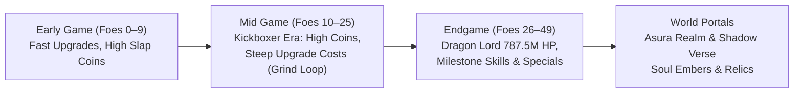
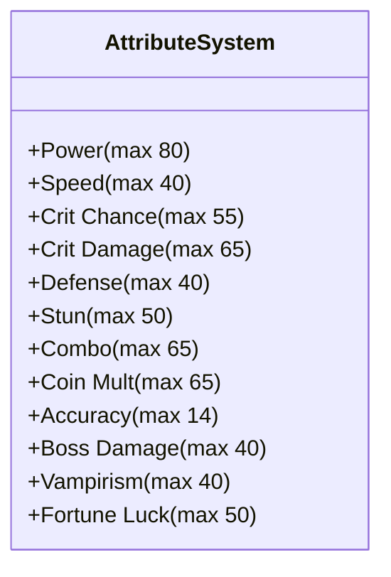
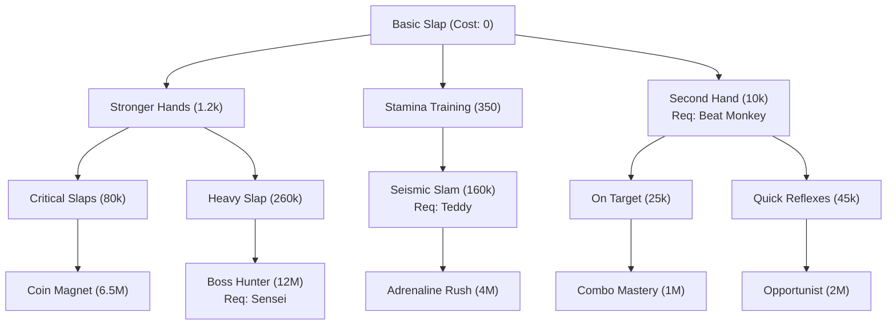

# These Hands — Game Design & Economy Bible
*Comprehensive Reference Guide for Combat Balance, Economy Scaling, Enemy Pools, and Progression Systems*

---

## 1. Executive Summary & Progression Philosophy

*These Hands* is built upon a hybrid arcade fighting and idle-progression loop designed to maximize tactile satisfaction, strategic stat allocation, and long-term grind engagement:

1. **Visually Immersive, Fast-Paced Currency Flow:**
   - Slapping an enemy releases rapid fountains of coins with floating text (`+80`, `+250`, `+750`, `+1,800`) and audio-visual feedback.
   - Coin payouts never feel dry or starved; players are showered with earnings on every hit and KO.
2. **The 3-Tier Piecewise Economy Loop:**
   - **Tier 1 (Enemies 0–9, Till Monkey King):** Fast-paced, low-friction onboarding. Upgrade costs are affordable (60 to 10k coins), allowing players to quickly build stats and feel powerful.
   - **Tier 2 (Enemies 10–25, Post-Monkey to Mid-Game):** The "Grind & Mastery" era. While battles yield 3,500–10,000+ coins, upgrade costs ramp up steeply (25k to 1M+ coins). Upgrades become momentous milestones requiring 8–20 fights, Hard clears, or Trio Gauntlets.
   - **Tier 3 (Enemies 26–50+, Endgame & World Portals):** Millions to Billions scaling. Dragon Lord caps World 0 at **787.5 Million HP**, requiring full mastery of Crits, Combos, Skills, and Specials. **Power cannot be maxed before entering the Shadow Verse.**

---

## 2. Combat & Coin Earning System

### 2.1 Slap Coin Generation (During Battle)
Every hit landed on an enemy generates instant battle coins according to the following formulas:

$$\text{Base Slap Coin} = \max\left(1, \text{round}\left(\text{Bounty} \times 0.10\right)\right)$$

$$\text{Bonus Fraction} = \min\left(1.0, \frac{\text{Damage Dealt}}{\max(1, \text{Enemy HP})} \times 5\right)$$

$$\text{Initial Gain} = \max\left(1, \text{round}\left(\text{Base Slap Coin} \times (1 + \text{Bonus}) \times \text{CoinMult}\right)\right)$$

#### Stage Multipliers:
* **Enemies 0 – 9 (Till Monkey King):** Multiplied by `slapEarlyMult` = **$3.5\times$** (or $2.0\times$ for bosses).
* **Enemies 10 – 24 (Post-Monkey / Kickboxer Era):** Multiplied by `slapMidMult` = **$2.2\times$** (or $2.0\times$ for bosses).
* **Critical Hit Bonus:** Adds $+50\%$ extra slap coins on crit (`slapCritPayFrac: 0.5`).
* **Fortune Luck Bonus:** Lucky slaps multiply slap coin earnings by **$3\times$** (`luckCoinMult: 3`).

#### Fight Slap Coin Cap & Taper:
* **Fight Cap:** For non-boss fights under Enemy 25, total slap coins collected in a single fight can reach **$175\%$ of the enemy's total kill bounty** (`slapEarlyCapFrac: 1.75`). For later fights, the cap is $135\%$ (`slapFightCapFrac: 1.35`).
* **Taper:** As accumulated fight hit coins approach the cap, gains taper off at $35\%$ rate (`slapTaperFrac: 0.35`), ensuring players receive rich payouts without infinite stall exploits.

---

### 2.2 Enemy Bounty & Defeat Payout
When an enemy is knocked out, a lump-sum bounty is awarded:

$$\text{Coin Rate} = \begin{cases} 0.50 & \text{if } i < 10 \\ \max\left(0.38, 0.55 \times 0.994^{i - 10}\right) & \text{if } i \ge 10 \end{cases}$$

$$\text{Bounty} = \max\left(30, \text{round}\left(\text{HP} \times \text{Coin Rate} \times 0.52\right)\right)$$

* **Boss Bonus:** Bosses (every 10th enemy: #9, #19, #29, #39, #49) receive a **$1.75\times$ multiplier** (`bossBonusMult: 1.75`) to their kill bounty.
* **Normal Kill Bonus:** Yields $+30\%$ bonus coin payout upon KO.
* **Hard Mode Multiplier:** Playing on Hard Mode grants a **$2.5\times$ coin payout multiplier** (`CONFIG.hard.coinMult: 2.5`), $5$ Gems on first clear, and $1.5\times$ Soul Embers.
* **Group Reward Bonus:** Defeating all 5 enemies in a group awards an immediate lump sum equal to **$1.5\times$ the group's total bounty**.

---

## 3. Enemy Health, Damage & Interval Roster

The game features 50 progressively escalating enemies in World 0, structured into 10 themed groups:

### 3.1 Mathematical Scaling Formulas

$$\text{Step} = i - 10$$

$$\text{HP}(i) = \begin{cases} 
\text{early}[i] & \text{if } i < 10 \\ 
2800 \times 1.255^{\text{Step}} & \text{if } 10 \le i \le 30 \\ 
2800 \times 1.255^{20} \times 1.442^{i - 30} & \text{if } i > 30 
\end{cases} \times (\text{Boss ? } 2.5 : \text{Elite ? } 1.55 : 1)$$

$$\text{Damage}(i) = \begin{cases} 
\text{earlyDmg}[i] & \text{if } i < 10 \\ 
64 \times 1.11^{\text{Step}} & \text{if } 10 \le i \le 30 \\ 
64 \times 1.11^{20} \times 1.14^{i - 30} & \text{if } i > 30 
\end{cases} \times (\text{Boss ? } 1.8 : \text{Elite ? } 1.4 : 1)$$

$$\text{Interval}(i) = \max\left(1.40\text{s}, 2.40\text{s} \times 0.988^i\right)$$

---

### 3.2 Complete 50-Enemy Roster Table

| # | Enemy Name | Role | Health (HP) | Attack Dmg | Attack Interval | Kill Bounty | Group |
|---|---|---|---|---|---|---|---|
| **1** | Training Dummy | Standard | **65** | 8 | 2.40s | 30 | Group 1: Backyard Brawl |
| **2** | Rubber Duck | Standard | **95** | 12 | 2.35s | 30 | Group 1: Backyard Brawl |
| **3** | Rubber Chicken | Standard | **140** | 15 | 2.30s | 36 | Group 1: Backyard Brawl |
| **4** | Cardboard Knight | Standard | **210** | 20 | 2.25s | 55 | Group 1: Backyard Brawl |
| **5** | Grumpy Teddy | **Mini-Boss** | **380** | 26 | 2.05s | 99 | Group 1: Backyard Brawl |
| **6** | Sassy Goblin Sprout | Standard | **440** | 26 | 2.20s | 114 | Group 2: Playpen Outlaws |
| **7** | Mime | Standard | **600** | 30 | 2.15s | 156 | Group 2: Playpen Outlaws |
| **8** | Cocky Goose | Standard | **820** | 36 | 2.10s | 213 | Group 2: Playpen Outlaws |
| **9** | Trash Panda | Elite | **1,150** | 44 | 2.05s | 299 | Group 2: Playpen Outlaws |
| **10** | Mischievous Monkey | **Boss** | **2,750** | 52 | 1.95s | **1,251** | Group 2: Playpen Outlaws |
| **11** | Bodybuilder | Standard | **3,200** | 64 | 2.13s | 915 | Group 3: Gym Rats |
| **12** | Luchador Wrestler | Standard | **4,016** | 71 | 2.10s | 1,142 | Group 3: Gym Rats |
| **13** | Kickboxer | Standard | **5,040** | 79 | 2.08s | **1,423** | Group 3: Gym Rats |
| **14** | Adult Boxer | Standard | **6,325** | 88 | 2.05s | 1,776 | Group 3: Gym Rats |
| **15** | Sumo Champion | **Mini-Boss** | **12,304** | 136 | 2.03s | 3,436 | Group 3: Gym Rats |
| **16** | Karate Kid | Standard | **9,985** | 108 | 2.00s | 2,781 | Group 4: Dojo Masters |
| **17** | Black Belt Sensei | Standard | **12,531** | 120 | 1.98s | 3,471 | Group 4: Dojo Masters |
| **18** | Drunken Master | Standard | **15,727** | 133 | 1.95s | 4,331 | Group 4: Dojo Masters |
| **19** | Shaolin Monk | Elite | **30,594** | 207 | 1.93s | 8,367 | Group 4: Dojo Masters |
| **20** | Grandmaster Shin | **Boss** | **61,785** | 296 | 1.84s | **29,293** | Group 4: Dojo Masters |
| **21** | Bouncer | Standard | **30,976** | 185 | 1.88s | 8,416 | Group 5: Alleyway Syndicate |
| **22** | Street Punk | Standard | **38,875** | 205 | 1.86s | 10,503 | Group 5: Alleyway Syndicate |
| **23** | Thug Enforcer | Standard | **48,788** | 228 | 1.84s | 13,107 | Group 5: Alleyway Syndicate |
| **24** | Knuckle Brawler | Standard | **61,229** | 253 | 1.82s | 16,350 | Group 5: Alleyway Syndicate |
| **25** | Syndicate Boss | **Mini-Boss** | **119,260** | 392 | 1.79s | 31,380 | Group 5: Alleyway Syndicate |
| **26** | Cyberpunk Grunt | Standard | **96,104** | 312 | 1.77s | 25,487 | Group 6: Cyber Underground |
| **27** | Neon Assassin | Standard | **120,611** | 346 | 1.75s | 31,805 | Group 6: Cyber Underground |
| **28** | Mech Soldier | Standard | **151,367** | 384 | 1.73s | 39,683 | Group 6: Cyber Underground |
| **29** | Cyber Cyborg | Elite | **294,074** | 597 | 1.71s | 76,578 | Group 6: Cyber Underground |
| **30** | Neon Overlord | **Boss** | **598,854** | 853 | 1.63s | **267,573** | Group 6: Cyber Underground |
| **31** | Stone Golem | Standard | **341,200** | 473 | 1.67s | 88,574 | Group 7: Ancient Ruins |
| **32** | Desert Guardian | Standard | **492,010** | 540 | 1.65s | 126,897 | Group 7: Ancient Ruins |
| **33** | Cursed Mummy | Standard | **709,479** | 615 | 1.63s | 181,770 | Group 7: Ancient Ruins |
| **34** | Anubis Warrior | Standard | **1,023,069** | 701 | 1.61s | 260,361 | Group 7: Ancient Ruins |
| **35** | Pharaoh King | **Mini-Boss** | **2,014,732** | 1,087 | 1.59s | 498,686 | Group 7: Ancient Ruins |
| **36** | Shadow Ninja | Standard | **2,130,950** | 911 | 1.57s | 536,252 | Group 8: Shadow Syndicate |
| **37** | Dark Assassin | Standard | **3,072,830** | 1,038 | 1.55s | 767,162 | Group 8: Shadow Syndicate |
| **38** | Shadow Weaver | Standard | **4,431,021** | 1,183 | 1.53s | 1,097,422 | Group 8: Shadow Syndicate |
| **39** | Void Walker | Elite | **9,902,333** | 1,889 | 1.51s | 2,437,341 | Group 8: Shadow Syndicate |
| **40** | Shadow Overlord | **Boss** | **20,260,579** | 2,698 | 1.44s | **8,517,952** | Group 8: Shadow Syndicate |
| **41** | Frost Giant | Standard | **13,293,425** | 1,538 | 1.48s | 3,267,422 | Group 9: Titan Peaks |
| **42** | Mountain Colossus | Standard | **19,169,119** | 1,753 | 1.46s | 4,682,514 | Group 9: Titan Peaks |
| **43** | Magma Titan | Standard | **27,641,870** | 1,999 | 1.44s | 6,709,444 | Group 9: Titan Peaks |
| **44** | Storm Colossus | Standard | **39,859,577** | 2,279 | 1.42s | 9,613,912 | Group 9: Titan Peaks |
| **45** | Titan Colossus | **Mini-Boss** | **78,319,488** | 3,532 | 1.40s | 18,245,308 | Group 9: Titan Peaks |
| **46** | Elder Dragon | Standard | **72,862,388** | 3,683 | 1.40s | 16,898,245 | Group 10: Dragon Lair |
| **47** | Dragon Champion | Standard | **105,067,563** | 4,199 | 1.40s | 24,203,364 | Group 10: Dragon Lair |
| **48** | Crystal Dragon | Standard | **151,507,426** | 4,787 | 1.40s | 34,664,899 | Group 10: Dragon Lair |
| **49** | Ancient Dragon | Elite | **338,634,249** | 7,640 | 1.40s | 76,527,141 | Group 10: Dragon Lair |
| **50** | Dragon Lord | **Final Boss** | **787,597,721** | 11,197 | 1.40s | **311,770,557** | Group 10: Dragon Lair |

---

## 4. Attribute Upgrade Structure & Pricing Curves

The game features 12 player attributes with distinct caps and progression impacts:

### 4.1 Attribute Configuration Table

| Attribute Key | Display Name | Base Cost | Max Cost | Max Level | Effect per Level | Hard Cap |
|---|---|---|---|---|---|---|
| `power` | Power | 60 | 1,850,000,000 | 80 | +3 Base Dmg & $1.08^{\text{lvl}}$ Growth | Unlimited |
| `speed` | Speed | 110 | 75,000,000 | 40 | $\times 0.98114$ Attack Interval | 0.70s base floor (0.35s with skills) |
| `critChance` | Crit Chance | 130 | 85,000,000 | 55 | +1.0% Critical Strike Chance | 75.0% cap |
| `critDamage` | Crit Damage | 90 | 65,000,000 | 65 | +10.0% Critical Strike Multiplier | No cap |
| `defense` | Defense | 220 | 95,000,000 | 40 | +1.0% Damage Reduction | 40.0% cap |
| `stun` | Stun | 130 | 80,000,000 | 50 | +0.5% Stun Chance & +0.02s Duration | 25% chance / 1.4s duration |
| `combo` | Combo | 75 | 60,000,000 | 65 | +1.0% Dmg per Stack & +0.4 Cap | Base 4 stacks |
| `coinMult` | Coin Mult. | 80 | 65,000,000 | 65 | +5.0% All Coin Earnings | No cap |
| `accuracy` | Accuracy | 95 | 30,000,000 | 14 | +1.0% Slap Hit Chance | 99.0% cap |
| `bossDamage` | Boss Hunter | 220 | 95,000,000 | 40 | +0.5% Damage vs Elites & Bosses | 20.0% cap |
| `vampirism` | Life Leech | 380 | 150,000,000 | 40 | +1 HP Leech per 5th Slap | No cap |
| `luck` | Fortune Luck | 140 | 85,000,000 | 50 | +0.5% Lucky Slap Chance | 25.0% cap |

---

### 4.2 The 3-Stage Mathematical Pricing Formula
Attribute pricing uses a seamless 3-stage piecewise function:

$$\text{Cost}(\text{key}, \text{lvl}) = \begin{cases}
\text{round}\left(\text{base} \times 1.78^{\text{lvl}}\right) & \text{if } \text{lvl} < 10 \\[6pt]
\text{round}\left(\text{cost}_9 \times 1.80 \times 1.28^{\text{lvl} - 9}\right) & \text{if } 10 \le \text{lvl} \le 25 \\[6pt]
\text{round}\left(\text{cost}_{25} \times \left(\frac{\text{maxCost}}{\text{cost}_{25}}\right)^{\frac{\text{lvl} - 25}{N - 25}}\right) & \text{if } 26 \le \text{lvl} < N \\[6pt]
\infty & \text{if } \text{lvl} \ge N
\end{cases}$$

#### Power & Speed Milestone Cost Comparison:

| Level | Power Cost | Speed Cost | Crit Chance Cost | Defense Cost | Life Leech Cost |
|---|---|---|---|---|---|
| **Lv 0** | 60 | 110 | 130 | 220 | 380 |
| **Lv 1** | 107 | 196 | 231 | 392 | 676 |
| **Lv 5** | 1,072 | 1,966 | 2,323 | 3,932 | 6,792 |
| **Lv 9** | 10,763 | 19,732 | 23,320 | 39,464 | 68,165 |
| **Lv 10** | **24,798** | **45,463** | 53,729 | 90,925 | 157,052 |
| **Lv 12** | **40,629** | **74,486** | 88,030 | 148,973 | 257,317 |
| **Lv 15** | **85,205** | **156,208** | 184,610 | 312,416 | 539,628 |
| **Lv 18** | **178,688** | **327,594** | 387,157 | 655,188 | 1,131,688 |
| **Lv 20** | **292,763** | **536,727** | 634,314 | 1,073,454 | 1,854,148 |
| **Lv 25** | **1,005,924** | **1,844,179** | 2,179,484 | 3,688,357 | 6,370,799 |
| **Lv 30** | 1,992,260 | 6,341,961 | 5,471,114 | 12,683,922 | 21,908,593 |
| **Lv 40** | 7,814,679 | **MAX** | 17,211,480 | **MAX** | **MAX** |
| **Lv 50** | 30,653,234 | MAX | 54,146,742 | MAX | MAX |
| **Lv 60** | 120,237,917 | MAX | MAX | MAX | MAX |
| **Lv 70** | 471,635,607 | MAX | MAX | MAX | MAX |
| **Lv 75** | 934,090,934 | MAX | MAX | MAX | MAX |
| **Lv 79** | 1,613,671,817 | MAX | MAX | MAX | MAX |
| **Lv 80** | **MAX** | MAX | MAX | MAX | MAX |

---

## 5. Player Level Up System & Abilities

Player level governs baseline health, attribute level gates, and unlocks permanent passive abilities:

### 5.1 Level Formulas
* **Player Max HP:** $\text{HP} = 100 + 25 \times (\text{PlayerLevel} - 1)$
* **Attribute Level Gate:** $\text{Gate} = (\text{PlayerLevel} \times 3) + (\text{DragonMastery} \times 10)$
  *(An attribute cannot exceed this gate unless player levels up or earns Dragon Mastery).*
* **Level Up Cost:**
  * Levels 1–9: $180 \times 2.15^{\text{lvl} - 1}$
  * Levels 10–25: Starts at 133k, scales at $1.62\times$ per level.
  * Levels 26–45: Starts at 18.5M, scales at $1.38\times$ per level.
  * Levels 46–50: Starts at 92.5B, scales at $1.28\times$ per level.

---

### 5.2 Passive Abilities (Levels 2 to 20+)

| Level | Ability Name | Category | In-Game Effect |
|---|---|---|---|
| **Lv 2** | Iron Palm | Damage | $+25\%$ damage on every slap permanently |
| **Lv 3** | Quickening | Agility | $+10\%$ slap speed |
| **Lv 4** | Thick Skin | Defense | Reduces incoming enemy attack damage by $15\%$ |
| **Lv 5** | Greed | Economy | $+20\%$ coins from all sources |
| **Lv 6** | Vampire Slap | Vitality | Every 6th slap heals you for 10 HP |
| **Lv 7** | Crit Surge | Critical | $+8\%$ critical strike chance |
| **Lv 8** | Second Wind | Clutch | Once per fight, when HP drops to 0, immediately recover $30\%$ HP |
| **Lv 9** | Boss Bane | Slayer | $+25\%$ damage against Group Elites and Bosses |
| **Lv 10** | Golden Aura | Economy | $+30\%$ coins earned |
| **Lv 11** | Counter Cadence | Tactics | After taking a hit, your next slap deals $2\times$ damage |
| **Lv 12** | Battle Focus | Tactics | At combo stack 8+, your slaps gain $+15\%$ stun chance |
| **Lv 13** | Tough Grit | Defense | When below $50\%$ HP, take $25\%$ less damage |
| **Lv 14** | Overcharge | Tactics | Critical hits discharge kinetic defense, dealing bonus damage equal to $50\%$ of your Defense stat |
| **Lv 15** | Giant Stature | Bulk | $+100$ Max HP, and striking an Elite or Boss grants $+1$ extra combo stack |
| **Lv 16** | Swift Recovery | Agility | Dodging or blocking an enemy attack boosts your slap speed by $+30\%$ for 2.5s |
| **Lv 17** | Midas Strike | Economy | Slaps landed within 0.8s of an enemy's attack timer grant $2\times$ coins |
| **Lv 18** | Iron Resolve | Purity | Every 25th slap cleanses all active debuffs (Burn, Slow, Specials Lock) and heals $10\%$ Max HP |
| **Lv 19** | Executioner | Slayer | Slaps deal $+50\%$ damage against enemies below $25\%$ HP |
| **Lv 20** | Godhand Awakening | Ultimate | Every 30th slap triggers Godhand Awakening: deals $3\times$ damage, stuns for 1.5s, and shakes the screen |
| **Lv 21+** | Mastery | Endless | $+2\%$ damage for every level above 20 indefinitely |

---

## 6. Skills Tree System & The "Second Hand"

The Skill Tree features 24 branching upgrades organized across Agility, Combo, Tactics, Defense, Damage, and Economy.

### 6.1 Complete Skills Reference Table

| Tier | Skill Name | Cost (Coins) | Prerequisite | Boss Gate | Detailed Effect |
|---|---|---|---|---|---|
| **T1** | Basic Slap | 0 | None | — | Starting slap ability. |
| **T1** | Stamina Training | 350 | Basic | — | $+50$ Max HP. |
| **T1** | Stronger Hands | 1,200 | Basic | — | $+20\%$ damage on every slap. |
| **T1** | **Second Hand** | **10,000** | **Basic** | **Boss #9 (Monkey)** | **Alternates Left and Right hands, doubling your slap cycle rate.** |
| **T2** | On Target | 25,000 | Second Hand | — | Combo stacks survive switching enemies (resets on defeat). |
| **T2** | Quick Reflexes | 45,000 | Second Hand | — | $+10\%$ slap attack speed. |
| **T2** | Deflect | 65,000 | Basic | — | Boss normal attacks spawn a parry ring; tap in time to deflect completely. |
| **T2** | Critical Slaps | 80,000 | Stronger Hands | — | $+5\%$ critical strike chance. |
| **T2** | Seismic Slam | 160,000 | Stamina | Boss #4 (Teddy) | Every 8th slap lands a slam dealing $4\times$ damage and dazing enemy for 1s. |
| **T2** | Heavy Slap | 260,000 | Stronger Hands | — | $12\%$ chance a slap lands HEAVY for $3\times$ damage. |
| **T2** | Precision Instinct | 420,000 | Stronger Hands | — | Gold weak spot flashes mid-fight; tap for a devastating $8.5\times$ precision crit. |
| **T3** | Combo Mastery | 1,000,000 | On Target | — | Combo cap $+5$ stacks and $+0.5\%$ damage per stack. |
| **T3** | Opportunist | 2,000,000 | Quick Reflexes | — | Slaps deal $+35\%$ damage to Stunned enemies. |
| **T3** | Adrenaline Rush | 4,000,000 | Seismic Slam | — | Below $35\%$ HP: gain $+20\%$ attack speed and $+25\%$ damage. |
| **T3** | Coin Magnet | 6,500,000 | Critical Slaps | — | $+20\%$ coins from every enemy KO. |
| **T3** | Boss Hunter | 12,000,000 | Heavy Slap | Boss #19 (Shin) | $+25\%$ damage vs Group Elites and Bosses. |
| **T4** | Acoustic Echo | 19,000,000 | Combo Mastery | — | Critical slaps have a $25\%$ chance to echo for $160\%$ bonus damage. |
| **T4** | Dual-Hand Technique | 30,000,000 | Opportunist | — | $+15\%$ attack speed (both hands blur). |
| **T4** | Unstoppable Hands | 45,000,000 | Adrenaline Rush | — | $+100$ Max HP and regenerate 2 HP/sec during battle. |
| **T4** | Kinetic Barrier | 68,000,000 | Adrenaline Rush | Boss #29 (Overlord) | Every 20 slaps builds a shield absorbing 30 damage (max 90). |
| **T4** | Treasure Hunter | 90,000,000 | Coin Magnet | — | Elites & Bosses drop $+50\%$ bonus coins, and defeat grants $+1$ extra Gem. |
| **T4** | Frenzy | 135,000,000 | Boss Hunter | — | Slaps charge FRENZY meter: triggers 10s of $+50\%$ damage and $+30\%$ speed. |
| **T4** | Colossus Bane | 180,000,000 | Boss Hunter | Boss #39 (Shadow) | $+35\%$ damage vs Giant, Titan, and Dragon enemies. |
| **T5** | Rapid Barrage | 245,000,000 | Dual-Hand | — | Every 10th slap unleashes a 5-slap rapid barrage. |
| **T5** | Bulwark of Aegis | 320,000,000 | Kinetic Barrier | — | Reflects $50\%$ of mitigated/blocked damage back at the attacker. |
| **T5** | Godhand Strike | 450,000,000 | Colossus Bane | Boss #49 (Dragon) | Slaps charge Godhand Ultimate ($20\times$ screen-shattering strike). |

---

## 7. Special Combat Skills & The "Guard" Overhaul

Specials are high-impact cooldown abilities unlocked by defeating major chapter bosses:

### 7.1 "Guard" Special (Formerly Aegis Barrier)
* **Visuals & Icon:** Features custom high-impact crossed martial arts guard fists: [guard.webp](file:///c:/these-hands/public/fx/guard.webp).
* **Mechanic:** Crossing both hands blocks incoming attacks with **$100\%$ complete damage negation** ($0$ damage taken; displays `"BLOCKED!"` floating text).
* **Upgrades:** Strictly limited to **2 upgrades only (Max Level = 3)** with endgame pricing:
  * **Level 1 (Unlocked at Boss #29):** Blocks **1 attack for 100% damage**. Cooldown: 26s.
  * **Level 2 (Upgrade 1):** Blocks **2 attacks for 100% damage**. Cost: **25,000,000 coins (25M)**. Cooldown: 23s.
  * **Level 3 (Upgrade 2):** Blocks **3 attacks for 100% damage**. Cost: **150,000,000 coins (150M)**. Cooldown: 20s.
  * Reaching Level 3 marks the skill as `"MAX LEVEL"`.

---

### 7.2 Other Specials

| Special Name | Unlocked By | Cooldown | Level Range | Cost Progression | Combat Effect |
|---|---|---|---|---|---|
| **Double Slap** | Boss #14 (Sumo) | 25s $\to$ 15s | Lv 1 $\to$ 5 | 105k, 525k, 2.6M, 13.1M | Both hands slam together for $4\times \to 10\times$ instant damage. |
| **Guard** | Boss #29 (Overlord) | 26s $\to$ 20s | Lv 1 $\to$ 3 | **25M, 150M** | Completely negates $100\%$ damage for $1 \to 3$ incoming hits. |
| **Uppercut Punch** | Boss #39 (Shadow) | 32s $\to$ 20s | Lv 1 $\to$ 5 | 1.5M, 8.25M, 45M, 250M | Crushing rising fist dealing $18\times \to 32\times$ damage + 3.0s stun. |

---

## 8. World Arts, Soul Embers & Relics

Defeating the Dragon Lord opens the **Worlds Portal** to World 0 (*Asura Realm*) and World 1 (*Shadow Verse*).

### 8.1 Soul Embers
* **Earning:** Awarded exclusively from World Portal battles (First clear gives large bonus; repeat clears grant baseline embers).
* **Void Beads Relic:** Equipping `beadsVoid` boosts Soul Ember earnings by $+20\% / +40\% / +60\%$.
* **Currency Role:** Used in the Artifacts Sanctuary to buy permanent, game-wide passive **World Arts**.

---

### 8.2 World Arts Table

| Icon | Artifact Name | Cost (Embers) | Permanent In-Game Effect |
|---|---|---|---|
| 🔁 | Echo Palm | 20 | Every 8th slap echoes — a phantom slap lands for $60\%$ bonus damage. |
| 💓 | Frenzy Heart | 15 | Your frenzy meter fills $+30\%$ faster. |
| 🕊️ | Phoenix Heart | 35 | Once per fight, a fatal blow leaves you standing at $25\%$ HP. |
| ⚡ | **Battle Trance** | **25** | **$+12\%$ slap speed AND $+25\%$ critical damage across all fights.** *(Replaces legacy Time Weaver).* |
| ✊ | Giant's Grip | 15 | $+1$ maximum precision weak-spot crits per fight. |
| 👁️ | Eagle Eye | 12 | Precision weak-spot targets stay open $0.6\text{s}$ longer. |
| 🪙 | Greed Mantra | 18 | $+25\%$ coins from all World Portal battles. |
| 🏹 | Boss Hunter | 25 | $+15\%$ damage against all bosses. |

---

### 8.3 Relics System (World Drops)

Relics drop from specific World Bosses and can be upgraded from ★1 to ★3:

| Icon | Relic Name | Source | ★1 Bonus | ★2 Bonus | ★3 Bonus | Stat Modified |
|---|---|---|---|---|---|---|
| 🔔 | Bronze War Bell | W0 S0 | $+10\%$ | $+20\%$ | $+30\%$ | Coins in world fights |
| 🗡️ | Rakshasa Fang | W0 S1 | $+8\%$ | $+16\%$ | $+24\%$ | Critical strike damage |
| 🔔 | Slumber Bell | W0 S2 | $-4\%$ | $-8\%$ | $-12\%$ | Enemy attack speed |
| 📯 | Horn of the Stampede | W0 S3 | $+10\%$ | $+20\%$ | $+30\%$ | Damage in world fights |
| 💀 | Skull of Whispers | W0 S4 | $-10\%$ | $-20\%$ | $-30\%$ | Weak-spot appearance interval |
| 👑 | Crown of Ten Kings | W0 S5 | $+15\%$ | $+25\%$ | $+40\%$ | Damage vs world final bosses |
| 🪵 | Splinter of the First Foe | W1 S0 | $+8\%$ | $+16\%$ | $+24\%$ | Damage vs non-bosses |
| 🧤 | Silent Glove | W1 S1 | $+4\%$ | $+7\%$ | $+10\%$ | Slap cycle speed |
| 🎭 | Puppet Strings | W1 S2 | $+15\%$ | $+30\%$ | $+45\%$ | Enemy special charge delay |
| 🐍 | Venomfang Coil | W1 S3 | $+10\%$ | $+20\%$ | $+30\%$ | Damage vs stunned enemies |
| 📿 | Beads of the Void | W1 S4 | $+20\%$ | $+40\%$ | $+60\%$ | Soul Embers earned |
| 🪞 | Mirror Palm | W1 S5 | Every 9 | Every 8 | Every 7 | Slaps between skin power procs |

---

## 9. Ads Cadence & Monetization Rules

Monetization is designed to be fair, predictable, and fully respectful of combat flow:

### 9.1 Interstitial Ads
* **Cadence:** Triggers after **every 3rd enemy fight fought** (`interstitialEveryFights: 3`).
* **Win/Loss Rule:** Counts every fight completed regardless of whether the player won or lost (`lossCount` + `winCount`).
* **Autoplay Protection:** When an ad displays, the combat engine pauses timers (`G.running = false`). The battle does not resume or advance until the user closes the ad.

---

### 9.2 Rewarded Ads & Boosters
* **2× Battle Coins Booster:** Watching a rewarded video activates a 10-minute timer doubling all coins earned (`G.adCoinBoostUntil`).
* **2× Battle Damage Booster:** Watching a rewarded video activates a 10-minute timer doubling all slap damage dealt (`G.adDmgBoostUntil`).
* **End-of-Fight Doubler:** Upon victory, players can watch a rewarded ad to double their entire fight haul (Slap coins + Bounty).
* **Boss Revive:** If defeated by a chapter boss, player can watch an ad to revive once at $50\%$ HP with specials refreshed.
