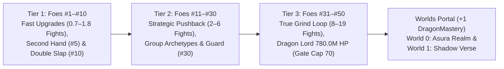
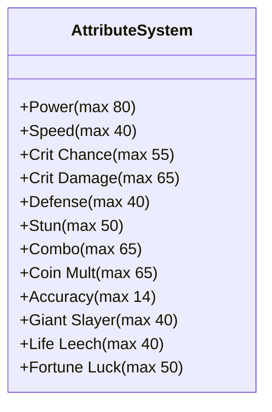
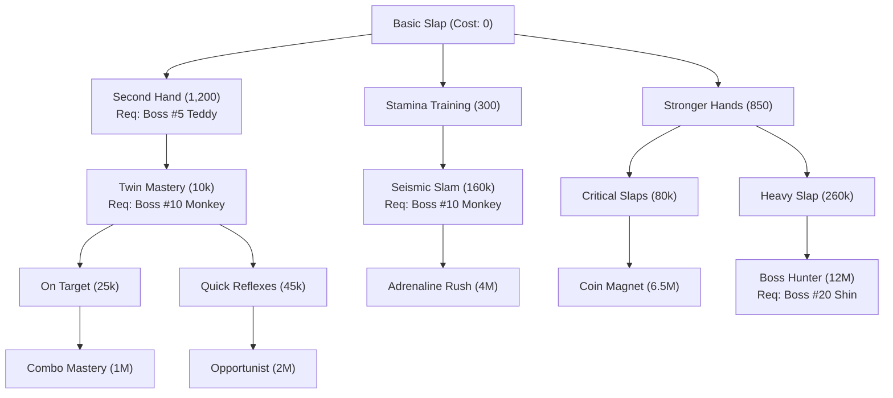

# These Hands — Game Design & Economy Bible (v2.2)
*Implementation-Ready Reference Guide for Combat Balance, Economy Scaling, Enemy Archetypes, and Progression Systems*

---

## 1. Executive Summary & Progression Philosophy

*These Hands* is built upon a hybrid arcade fighting and idle-progression loop designed to maximize tactile satisfaction, strategic stat allocation, and long-term grind engagement:

1. **Strictly Monotonic, Visually Immersive Currency Flow:**
   - Slapping an enemy releases rapid fountains of coins with floating text (`+80`, `+250`, `+750`, `+1,800`) and audio-visual feedback.
   - Repeat fight payouts **strictly increase across all 50 enemies** in the **Mortal Realm** (Base Campaign)—including immediately after every Mini-Boss and Chapter Boss—so players are always rewarded for pushing forward rather than camping on earlier stages.
2. **The 3-Tier Piecewise Economy Loop (Mortal Realm):**
   - **Tier 1 (Enemies #1–#10, Till Mischievous Monkey):** Fast-paced, hyper-addictive onboarding (`0.7–1.8 fights` per stat upgrade). Players unlock **Second Hand** at Mini-Boss #5 (*Grumpy Teddy*) within the first few minutes to experience the signature alternating-hand rhythm early, and unlock their first active special (**Double Slap**) at Boss #10 (*Mischievous Monkey*).
   - **Tier 2 (Enemies #11–#30, Gym Rats to Neon Overlord):** The "Strategic Pushback & Active Specials" era (`2.0–6.0 fights` per stat upgrade). Groups introduce distinct combat debuffs (*Knockback*, *Specials Lock*), requiring balanced investment across Power, Speed, Crit, Defense, and active Specials (*Double Slap*, *Guard*).
   - **Tier 3 (Enemies #31–#50, Ancient Ruins to Dragon Lord):** The "Grind & Mastery" era (`8.0–19.0 fights` per stat rotation). Dragon Lord caps the Mortal Realm at **780.0 Million HP**, requiring Hard Mode ($4.75\times$ base bounty jackpot) farming, Trio Gauntlets, 10-level Power milestones, and active parry/weak-spot execution. **In the Mortal Realm, `PlayerLevel` is capped at `35` (`Gate = 70`) and `Power` scales to a `12B` max cost, ensuring Levels 71–80 can only be unlocked after defeating `#50 Dragon Lord` and opening the Worlds Portal (*World 0: Asura Realm* & *World 1: Shadow Verse*).**

---

## 2. Combat & Coin Earning System

### 2.1 Slap Coin Generation (During Battle)
In Normal Mode, every hit landed on an enemy generates instant battle coins according to the following formulas *(Note: Hard Mode disables per-slap coins in favor of a high-stakes victory payout; see Section 3.3)*:

$$\text{Base Slap Coin} = \max\left(1, \text{round}\left(\text{Bounty} \times 0.10\right)\right)$$

$$\text{Bonus Fraction} = \min\left(1.0, \frac{\text{Damage Dealt}}{\max(1, \text{Enemy HP})} \times 5\right)$$

$$\text{Initial Gain} = \max\left(1, \text{round}\left(\text{Base Slap Coin} \times (1 + \text{Bonus}) \times \text{CoinMult}\right)\right)$$

#### Stage Multipliers (1-Indexed Enemy Number $i \in [1, 50]$):
* **Enemies #1 – #10 (Tier 1):** Multiplied by `slapEarlyMult` $= 3.0\times$ (or $2.0\times$ for bosses).
* **Enemies #11 – #24 (Tier 2):** Multiplied by `slapMidMult` $= 2.5\times$ (or $2.0\times$ for bosses).
* **Enemies #25 – #50 (Tier 3):** Multiplied by `slapLateMult` $= 2.0\times$ (or $1.75\times$ for bosses).
* **Critical Hit Bonus:** Adds $+50\%$ extra slap coins on crit (`slapCritPayFrac: 0.5`).
* **Fortune Luck Bonus:** Lucky slaps multiply slap coin earnings by $3\times$ (`luckCoinMult: 3`).

#### Fight Slap Coin Cap & Softened Taper:
* **Fight Cap:** For Enemies #1–#10, total slap coins collected in a single fight can reach **$175\%$ of the enemy's total kill bounty** (`slapEarlyCapFrac: 1.75`). For Enemies #11–#50, the cap expands to **$225\%$** (`slapFightCapFrac: 2.25`) so longer, tougher fights reward extra hits.
* **Taper:** Once accumulated fight hit coins reach the cap, additional slaps continue paying at a **$65\%$ rate** (`slapTaperFrac: 0.65`) rather than drying up—ensuring players feel rewarded even during prolonged boss attempts or productive losses.

---

### 2.2 Enemy Bounty, Repeat Payouts & First-Clear Boss Chests
When an enemy is knocked out, a lump-sum bounty is awarded with **zero rate decay**:

$$\text{Coin Rate}(i) = \begin{cases} 0.50 & \text{if } 1 \le i \le 10 \\ 0.55 & \text{if } i \ge 11 \end{cases}$$

$$\text{Bounty}(i) = \max\left(30, \text{round}\left(\text{HP}(i) \times \text{Coin Rate}(i) \times 0.52 \times \text{BossMult}\right)\right)$$

* **Repeat Boss Bonus (`bossBonusMult: 1.35`):** Chapter Bosses (#10, #20, #30, #40, #50) receive a $1.35\times$ repeat kill bounty multiplier while keeping their repeatable HP scaled cleanly below the next group's opener—guaranteeing that **Enemy $i+1$ always pays more than Enemy $i$**.
* **One-Time Boss & Mini-Boss First-Clear Chests:** Defeating any Mini-Boss or Chapter Boss for the **first time** awards an immediate **First-Clear Chest** ($2.5\times$ bonus coin jackpot + Gems + Skill/Special/Mastery unlock), delivering an exciting milestone surge without distorting repeat farm math:

| Boss / Mini-Boss | First-Clear Bonus Coins | First-Clear Gems | Milestone Unlock |
|---|---|---|---|
| **#5 Grumpy Teddy** *(Mini-Boss)* | $+220$ | $+2\text{ Gems}$ | Unlocks **Second Hand** (1,200 coins) |
| **#10 Mischievous Monkey** *(Boss)* | $+1,850$ | $+5\text{ Gems}$ | Unlocks **Double Slap** Special & **Twin Mastery** |
| **#15 Sumo Champion** *(Mini-Boss)* | $+5,400$ | $+2\text{ Gems}$ | Unlocks Group 4 (*Dojo Masters*) |
| **#20 Grandmaster Shin** *(Boss)* | $+23,500$ | $+5\text{ Gems}$ | Unlocks **Boss Hunter** Skill |
| **#25 Syndicate Boss** *(Mini-Boss)* | $+65,000$ | $+2\text{ Gems}$ | Unlocks Group 6 (*Cyber Underground*) |
| **#30 Neon Overlord** *(Boss)* | $+285,000$ | $+5\text{ Gems}$ | Unlocks **Guard** Special & **Kinetic Barrier** |
| **#35 Pharaoh King** *(Mini-Boss)* | $+1,150,000$ | $+3\text{ Gems}$ | Unlocks Group 8 (*Shadow Syndicate*) |
| **#40 Shadow Overlord** *(Boss)* | $+7,200,000$ | $+5\text{ Gems}$ | Unlocks **Uppercut Punch** Special & **Colossus Bane** |
| **#45 Titan Colossus** *(Mini-Boss)* | $+30,000,000$ | $+3\text{ Gems}$ | Unlocks Group 10 (*Dragon Lair*) |
| **#50 Dragon Lord** *(Final Boss)* | $+750,000,000$ | $+10\text{ Gems}$ | Grants **`+1 DragonMastery`**, unlocks Player Lv `36–50` & **Worlds Portal** |

* **Normal Kill Bonus:** Yields $+30\%$ bonus coin payout upon KO (`1.30x Bounty` + accumulated slap coins).
* **Hard Mode Multiplier:** Hard Mode uses the **exact same enemy** with boosted stats, awards **$0$ per-slap coins** during combat and **$0$ coins on defeat**, and grants a **$4.75\times$ Base Bounty jackpot** upon victory (`CONFIG.hard.coinMult: 4.75`), $+5\text{ Gems}$ on first clear, and $1.5\times$ Soul Embers (see Section 3.3).
* **Group Reward Bonus:** Defeating all 5 enemies in a group awards an immediate lump sum equal to **$1.5\times$ the group's total bounty**.

---

## 3. Enemy Health, Damage & Archetype Roster (Mortal Realm)

The Mortal Realm (Base Campaign) features 50 progressively escalating enemies structured into 10 themed groups. All tables and boss gates use **1-indexed** numbering ($i \in [1, 50]$, where internal array index $\text{idx} = i - 1$).

### 3.1 Monotonic Scaling Architecture & Static Lookup Specification
To eliminate post-boss payout drops while preserving hand-tuned endgame boss thresholds in Group 10 (`52M` $\to$ `780M`), **Table 3.2's 50 HP and Attack Damage values are stored directly as explicit 50-element lookup arrays (`ENEMY_HP[50]` and `ENEMY_DMG[50]`)** in `CONFIG` so runtime combat matches Table 3.2 to the exact integer:

$$\text{GroupIndex}(i) = \left\lfloor \frac{i - 1}{5} \right\rfloor \quad (0 \text{ to } 9)$$

* **HP Progression (`ENEMY_HP[50]`):** Incorporates a $1.12^{\text{GroupIndex}(i)}$ group step alongside controlled Mini-Boss ($1.28\times$) and Chapter Boss ($1.38\times$) multipliers so that every group opener ($i \in \{6, 11, 16, 21, 26, 31, 36, 41, 46\}$) strictly exceeds the previous group's Boss in both HP and Kill Bounty, culminating in **#50 Dragon Lord at `780,000,000 HP`**.
* **Attack Damage Progression (`ENEMY_DMG[50]`):** Follows a tempered exponential curve with hand-tuned late-game Chapter Boss damage (`#40 Shadow Overlord` at `1,780` and `#50 Dragon Lord` at `4,717`) stored directly in `ENEMY_DMG[50]` to guarantee multi-hit survivability:

$$\text{BaseDamageCurve}(i) = \begin{cases} 
\text{earlyDmg}[i] & \text{if } 1 \le i \le 10 \\[4pt]
64 \times 1.105^{i - 11} & \text{if } 11 \le i \le 30 \\[4pt]
64 \times 1.105^{19} \times 1.095^{i - 30} & \text{if } 31 \le i \le 50 
\end{cases} \times \begin{cases} 1.65 & \text{Boss} \\ 1.35 & \text{Mini-Boss / Elite} \\ 1.00 & \text{Standard} \end{cases}$$

* **Attack Interval Formula:**

$$\text{Interval}(i) = \max\left(1.40\text{s}, 2.40\text{s} \times 0.988^{i - 1}\right)$$

---

### 3.2 Complete 50-Enemy Roster Table (Strictly Increasing Payouts)

| # | Enemy Name | Role | Health (HP) | Attack Dmg | Attack Interval | Kill Bounty | Group |
|---|---|---|---|---|---|---|---|
| **1** | Training Dummy | Standard | **65** | 8 | 2.40s | **30** | Group 1: Backyard Brawl |
| **2** | Rubber Duck | Standard | **95** | 12 | 2.35s | **30** | Group 1: Backyard Brawl |
| **3** | Rubber Chicken | Standard | **140** | 15 | 2.30s | **36** | Group 1: Backyard Brawl |
| **4** | Cardboard Knight | Standard | **210** | 20 | 2.25s | **55** | Group 1: Backyard Brawl |
| **5** | Grumpy Teddy | **Mini-Boss** | **340** | 26 | 2.05s | **88** | Group 1: Backyard Brawl |
| **6** | Sassy Goblin Sprout | Standard | **420** | 28 | 2.20s | **109** | Group 2: Playpen Outlaws |
| **7** | Mime | Standard | **580** | 32 | 2.15s | **151** | Group 2: Playpen Outlaws |
| **8** | Cocky Goose | Standard | **800** | 38 | 2.10s | **208** | Group 2: Playpen Outlaws |
| **9** | Trash Panda | Elite | **1,150** | 46 | 2.05s | **299** | Group 2: Playpen Outlaws |
| **10** | Mischievous Monkey | **Boss** | **2,100** | 54 | 1.95s | **737** | Group 2: Playpen Outlaws |
| **11** | Bodybuilder | Standard | **2,850** | 64 | 2.13s | **815** | Group 3: Gym Rats |
| **12** | Luchador Wrestler | Standard | **3,550** | 71 | 2.10s | **1,015** | Group 3: Gym Rats |
| **13** | Kickboxer | Standard | **4,420** | 78 | 2.08s | **1,264** | Group 3: Gym Rats |
| **14** | Adult Boxer | Standard | **5,500** | 86 | 2.05s | **1,573** | Group 3: Gym Rats |
| **15** | Sumo Champion | **Mini-Boss** | **7,600** | 128 | 2.03s | **2,174** | Group 3: Gym Rats |
| **16** | Karate Kid | Standard | **8,400** | 105 | 2.00s | **2,402** | Group 4: Dojo Masters |
| **17** | Black Belt Sensei | Standard | **10,500** | 117 | 1.98s | **3,003** | Group 4: Dojo Masters |
| **18** | Drunken Master | Standard | **13,100** | 129 | 1.95s | **3,747** | Group 4: Dojo Masters |
| **19** | Shaolin Monk | Elite | **17,500** | 185 | 1.93s | **5,005** | Group 4: Dojo Masters |
| **20** | Grandmaster Shin | **Boss** | **24,500** | 260 | 1.84s | **9,459** | Group 4: Dojo Masters |
| **21** | Bouncer | Standard | **34,500** | 174 | 1.88s | **9,867** | Group 5: Alleyway Syndicate |
| **22** | Street Punk | Standard | **43,000** | 192 | 1.86s | **12,298** | Group 5: Alleyway Syndicate |
| **23** | Thug Enforcer | Standard | **53,500** | 212 | 1.84s | **15,301** | Group 5: Alleyway Syndicate |
| **24** | Knuckle Brawler | Standard | **66,500** | 234 | 1.82s | **19,019** | Group 5: Alleyway Syndicate |
| **25** | Syndicate Boss | **Mini-Boss** | **92,000** | 345 | 1.79s | **26,312** | Group 5: Alleyway Syndicate |
| **26** | Cyberpunk Grunt | Standard | **102,000** | 286 | 1.77s | **29,172** | Group 6: Cyber Underground |
| **27** | Neon Assassin | Standard | **127,000** | 316 | 1.75s | **36,322** | Group 6: Cyber Underground |
| **28** | Mech Soldier | Standard | **158,000** | 349 | 1.73s | **45,188** | Group 6: Cyber Underground |
| **29** | **Chrome Juggernaut** | Elite | **212,000** | 495 | 1.71s | **60,632** | Group 6: Cyber Underground |
| **30** | Neon Overlord | **Boss** | **295,000** | 690 | 1.63s | **113,900** | Group 6: Cyber Underground |
| **31** | Stone Golem | Standard | **420,000** | 467 | 1.67s | **120,120** | Group 7: Ancient Ruins |
| **32** | Desert Guardian | Standard | **580,000** | 512 | 1.65s | **165,880** | Group 7: Ancient Ruins |
| **33** | Cursed Mummy | Standard | **800,000** | 560 | 1.63s | **228,800** | Group 7: Ancient Ruins |
| **34** | Anubis Warrior | Standard | **1,105,000** | 613 | 1.61s | **316,030** | Group 7: Ancient Ruins |
| **35** | Pharaoh King | **Mini-Boss** | **1,620,000** | 890 | 1.59s | **463,320** | Group 7: Ancient Ruins |
| **36** | Shadow Ninja | Standard | **1,850,000** | 736 | 1.57s | **529,100** | Group 8: Shadow Syndicate |
| **37** | Dark Assassin | Standard | **2,550,000** | 805 | 1.55s | **729,300** | Group 8: Shadow Syndicate |
| **38** | Shadow Weaver | Standard | **3,520,000** | 882 | 1.53s | **1,006,720** | Group 8: Shadow Syndicate |
| **39** | Void Walker | Elite | **5,150,000** | 1,280 | 1.51s | **1,472,900** | Group 8: Shadow Syndicate |
| **40** | Shadow Overlord | **Boss** | **7,450,000** | 1,780 | 1.44s | **2,876,445** | Group 8: Shadow Syndicate |
| **41** | Frost Giant | Standard | **10,600,000** | 1,158 | 1.48s | **3,031,600** | Group 9: Titan Peaks |
| **42** | Mountain Colossus | Standard | **14,750,000** | 1,268 | 1.46s | **4,218,500** | Group 9: Titan Peaks |
| **43** | Magma Titan | Standard | **20,500,000** | 1,388 | 1.44s | **5,863,000** | Group 9: Titan Peaks |
| **44** | **Tempest Giant** | Standard | **28,500,000** | 1,520 | 1.42s | **8,151,000** | Group 9: Titan Peaks |
| **45** | Titan Colossus | **Mini-Boss** | **42,500,000** | 2,220 | 1.40s | **12,155,000** | Group 9: Titan Peaks |
| **46** | Elder Dragon | Standard | **52,000,000** | 1,823 | 1.40s | **14,872,000** | Group 10: Dragon Lair |
| **47** | Dragon Champion | Standard | **92,000,000** | 1,996 | 1.40s | **26,312,000** | Group 10: Dragon Lair |
| **48** | Crystal Dragon | Standard | **165,000,000** | 2,186 | 1.40s | **47,190,000** | Group 10: Dragon Lair |
| **49** | Ancient Dragon | Elite | **310,000,000** | 3,180 | 1.40s | **88,660,000** | Group 10: Dragon Lair |
| **50** | Dragon Lord | **Final Boss** | **780,000,000** | 4,717 | 1.40s | **301,158,000** | Group 10: Dragon Lair |

---

### 3.3 Hard Mode Scaling & High-Stakes Grind Loop

Hard Mode does **not** change the enemy roster, visuals, names, or attack behaviors—it toggles the **exact same 50 enemies** into Hard Mode once their Normal Mode stage has been defeated, serving as the primary **active coin-farming engine** during Tier 2 and Tier 3 progression.

#### Hard Mode Stat & Payout Formulas (Applied to Any Enemy $i \in [1, 50]$):

$$\text{HP}_{\text{Hard}}(i) = \text{round}\left(\text{HP}_{\text{Normal}}(i) \times 1.75\right)$$

$$\text{Damage}_{\text{Hard}}(i) = \text{round}\left(\text{Damage}_{\text{Normal}}(i) \times 1.25\right)$$

$$\text{Interval}_{\text{Hard}}(i) = \text{Interval}_{\text{Normal}}(i) \quad \text{(Unchanged)}$$

$$\text{Payout}_{\text{Hard}}(i) = \begin{cases} \text{round}\left(\text{Bounty}_{\text{Normal}}(i) \times 4.75\right) & \text{on Victory (KO)} \\ 0 & \text{per Slap or on Defeat} \end{cases}$$

#### `CONFIG.hard` Multipliers & Rules:
* **`hpMult: 1.75` ($1.75\times$ Normal HP) & `dmgMult: 1.25` ($1.25\times$ Normal Damage):** Equivalent to pushing $2$–$3$ stages ahead in Normal Mode without causing unfair one-shots.
* **`intervalMult: 1.00` (Unchanged Attack Interval):** Preserves exact attack rhythms so player muscle memory for **Deflect** parry rings and **Guard** timing transfers seamlessly.
* **`coinMult: 4.75` ($4.75\times$ Base Bounty on KO, `noSlapCoins: true`):** Drops **$0$ coins per slap** and **$0$ coins on defeat**, paying a lump-sum jackpot upon victory that yields **$1.65\times$–$1.90\times$ more total coins per win** than Normal Mode and pairs directly with the **$2\times$ End-of-Fight Rewarded Ad**.
* **Group Mastery Bonus:** Clearing all 5 enemies in a group on Hard Mode awards a one-time **Group Mastery Bonus** of **$+15\text{ Gems}$** and a **permanent $+2\%$ global Coin Multiplier**.

#### Hard Mode Checkpoint Examples (Same Enemies, Normal Total Haul vs. Hard KO Jackpot):

| Enemy # & Name | Normal HP | Hard HP ($1.75\times$) | Normal Dmg | Hard Dmg ($1.25\times$) | Normal Total Haul *(KO + Slaps)* | Hard KO Payout ($4.75\times$) |
|---|---|---|---|---|---|---|
| **#10 Mischievous Monkey** *(Boss)* | 2,100 | **3,675** | 54 | **68** | ~1,916 | **3,501** |
| **#20 Grandmaster Shin** *(Boss)* | 24,500 | **42,875** | 260 | **325** | ~26,012 | **45,130** |
| **#30 Neon Overlord** *(Boss)* | 295,000 | **516,250** | 690 | **863** | ~313,225 | **541,025** |
| **#40 Shadow Overlord** *(Boss)* | 7,450,000 | **13,037,500** | 1,780 | **2,225** | ~8,197,868 | **13,663,114** |
| **#45 Titan Colossus** *(Mini-Boss)* | 42,500,000 | **74,375,000** | 2,220 | **2,775** | ~34,641,750 | **57,736,250** |
| **#50 Dragon Lord** *(Final Boss)* | 780,000,000 | **1,365,000,000** | 4,717 | **5,896** | ~858,300,300 | **1,430,500,500** |

---

### 3.4 Group Combat Archetypes & Enemy Specials / Debuffs
To give each of the 10 groups a distinct tactical identity—and directly ground player cleanse passives (*Iron Resolve* at Lv 18), parry timing (*Deflect*), and special-delay relics (*Puppet Strings* `W1 S2`)—every 3rd enemy attack in Groups 3–10 triggers a **Group Signature Move**:

| Group | Theme | Signature Move (Every 3rd Attack) | Debuff / Tactical Effect | Counterplay |
|---|---|---|---|---|
| **G1: Backyard Brawl** | Tutorial | None (Basic Attacks) | Pure rhythm onboarding. | Learn slap pacing. |
| **G2: Playpen Outlaws** | Tricksters | **Feint Toss** | Slight visual wind-up before strike (Boss #10 spawns parry ring). | First parry ring practice. |
| **G3: Gym Rats** | Heavyweights | **Haymaker Knockback** | Resets player's current Combo stack to $0$ on hit. | Upgrade **Stun** or **Deflect** parry. |
| **G4: Dojo Masters** | Martial Artists | **Iron Guard Stance** | Reduces incoming slap damage by $30\%$ for $2.0\text{s}$. | Save **Double Slap** until stance drops. |
| **G5: Alleyway Syndicate** | Brawlers | **Sucker Punch** | Deals $1.4\times$ damage and applies **Daze** ($-15\%$ slap speed for $2.5\text{s}$). | Time **Guard** or **Deflect** parry. |
| **G6: Cyber Underground** | Tech & Mechs | **EMP Pulse** | Applies **Specials Lock** for $3.0\text{s}$ (freezes Special cooldowns). | **Iron Resolve** (Lv 18) or **Guard**. |
| **G7: Ancient Ruins** | Cursed Relics | **Sands of Torpor** | Applies **Slow** ($-25\%$ slap attack speed for $3.5\text{s}$). | **Iron Resolve** cleanse or high Speed. |
| **G8: Shadow Syndicate** | Assassins | **Shadow Veil** | Grants $+15\%$ dodge chance to enemy for $2.5\text{s}$ (see formula below). | Upgrade **Accuracy** toward $99\%$. |
| **G9: Titan Peaks** | Elementals | **Magma Slam** | Applies **Burn DoT** ($3\%$ Player Max HP/sec for $3.0\text{s}$). | **Life Leech** & **Iron Resolve** cleanse. |
| **G10: Dragon Lair** | Dragons | **Dragonfire Breath** | Deals $1.5\times$ damage + **Burn DoT** ($4\%$ Max HP/sec for $3.0\text{s}$). | Chain **Guard**, **Stun**, and **Uppercut**. |

#### Group 8 `Shadow Veil` Dodge Formula:
$$\text{Effective Hit Chance} = \max\left(50\%, \text{Player Accuracy} - \text{Enemy Dodge}\right)$$
*(At capped $99\%$ Accuracy, `Shadow Veil` reduces player hit rate to $84\%$; at base $85\%$ Accuracy, hit rate drops to $70\%$, making Accuracy upgrades impactful before entering Group 8).*

---

### 3.5 Enemy Roster Changelog (`v2.0` $\to$ `v2.2` Updates)
To eliminate post-boss payout drops and remove redundant naming, the following updates were applied to the 50-enemy roster:

1. **Name Refinements (2 Enemies Renamed for Thematic Clarity):**
   * **#29 `Cyber Cyborg` $\to$ `Chrome Juggernaut`:** Eliminated the redundant *"Cyber Cyborg"* phrasing in Group 6 (*Cyber Underground*).
   * **#44 `Storm Colossus` $\to$ `Tempest Giant`:** Differentiated #44 from Mini-Boss #45 (*Titan Colossus*) in Group 9 (*Titan Peaks*).
2. **Stat & Bounty Recalibration (Eliminating Post-Boss Income Dips):**
   * **Mini-Bosses (#5, #15, #25, #35, #45) & Chapter Bosses (#10, #20, #30, #40):** Repeatable HP and Kill Bounties were smoothly anchored to $1.28\times$–$1.38\times$ of the preceding enemy, moving their oversized $2.5\times$ coin jackpots into **One-Time First-Clear Chests** (Section 2.2).
   * **Post-Boss Openers (#11, #16, #21, #26, #31, #36, #41, #46):** Calibrated via the $1.12^{\text{GroupIndex}}$ step so that every single transition from a Boss or Mini-Boss into the next Standard enemy now yields a **positive bounty increase** (`+4.3%` to `+23.9%`) instead of the legacy `-8%` to `-62.8%` drops:

| Transition | Legacy `v2.0` Bounty Change | Updated `v2.2` Bounty Change | Result |
|---|---|---|---|
| **#5 Teddy $\to$ #6 Goblin** | $114 \to 114$ ($0\%$) | $88 \to 109$ (**$+23.9\%$**) | Smooth upward step (+220 First-Clear Chest on #5) |
| **#10 Monkey $\to$ #11 Bodybuilder** | $965 \to 1,044$ ($+8.2\%$) | $737 \to 815$ (**$+10.6\%$**) | Smooth upward step (+1,850 First-Clear Chest on #10) |
| **#15 Sumo $\to$ #16 Karate Kid** | $4,014 \to 3,250$ (**$-19.0\%$**) | $2,174 \to 2,402$ (**$+10.5\%$**) | **Dip eliminated** (+5,400 First-Clear Chest on #15) |
| **#20 Shin $\to$ #21 Bouncer** | $27,210 \to 10,118$ (**$-62.8\%$**) | $9,459 \to 9,867$ (**$+4.3\%$**) | **Dip eliminated** (+23.5k First-Clear Chest on #20) |
| **#25 Syndicate $\to$ #26 Grunt** | $38,905 \to 31,500$ (**$-19.0\%$**) | $26,312 \to 29,172$ (**$+10.9\%$**) | **Dip eliminated** (+65k First-Clear Chest on #25) |
| **#30 Overlord $\to$ #31 Golem** | $263,733 \to 111,119$ (**$-57.9\%$**) | $113,900 \to 120,120$ (**$+5.5\%$**) | **Dip eliminated** (+285k First-Clear Chest on #30) |
| **#35 Pharaoh $\to$ #36 Ninja** | $704,238 \to 646,081$ (**$-8.3\%$**) | $463,320 \to 529,100$ (**$+14.2\%$**) | **Dip eliminated** (+1.15M First-Clear Chest on #35) |
| **#40 Shadow $\to$ #41 Frost Giant** | $8,915,789 \to 3,756,518$ (**$-57.9\%$**) | $2,876,445 \to 3,031,600$ (**$+5.4\%$**) | **Dip eliminated** (+7.2M First-Clear Chest on #40) |
| **#45 Titan $\to$ #46 Elder Dragon** | $23,807,585 \to 21,841,541$ (**$-8.3\%$**) | $12,155,000 \to 14,872,000$ (**$+22.4\%$**) | **Dip eliminated** (+30M First-Clear Chest on #45) |

---

## 4. Attribute Upgrade Structure & Pricing Curves

The game features 12 player attributes with distinct caps and progression impacts:

### 4.1 Attribute Configuration Table (`v2.2` Balanced Scaling)

| Attribute Key | Display Name | Base Cost | Max Cost | Max Level ($N$) | Effect per Level | Hard Cap |
|---|---|---|---|---|---|---|
| `power` | Power | 60 | **12,000,000,000** | 80 | $+3$ Base Dmg, $1.095^{\text{lvl}}$ Growth, & $\times 1.5$ Milestone every 10 levels | Unlimited *(Lv 71–80 gated behind Dragon Lord)* |
| `speed` | Speed | 110 | 75,000,000 | 40 | $\times 0.98114$ Attack Interval | 0.70s base floor (0.35s w/ skills) |
| `critChance` | Crit Chance | 130 | 85,000,000 | 55 | $+1.0\%$ Critical Strike Chance | $75.0\%$ cap |
| `critDamage` | Crit Damage | 90 | 65,000,000 | 65 | $+10.0\%$ Critical Strike Multiplier | No cap |
| `defense` | Defense | 220 | 95,000,000 | 40 | $+1.0\%$ Damage Reduction | $40.0\%$ cap |
| `stun` | Stun | 130 | 80,000,000 | 50 | $+0.5\%$ Stun Chance & $+0.02\text{s}$ Duration | $25\%$ chance / 1.4s duration |
| `combo` | Combo | 75 | 60,000,000 | 65 | $+1.0\%$ Dmg per Stack & $+0.4$ Cap | Base 4 stacks |
| `coinMult` | Coin Mult. | 80 | 65,000,000 | 65 | $+5.0\%$ All Coin Earnings | No cap |
| `accuracy` | Accuracy | 95 | 30,000,000 | 14 | $+1.0\%$ Slap Hit Chance | $99.0\%$ cap |
| `bossDamage` | **Giant Slayer** | 220 | 95,000,000 | 40 | **$+1.5\%$ Damage vs Elites, Mini-Bosses & Bosses** | **$60.0\%$ cap** |
| `vampirism` | **Life Leech** | 380 | 150,000,000 | 40 | **$+0.15\%$ of Player Max HP healed every 5th Slap** | **$6.0\%$ Max HP / 5th slap** |
| `luck` | Fortune Luck | 140 | 85,000,000 | 50 | $+0.5\%$ Lucky Slap Chance | $25.0\%$ cap |

---

### 4.2 Dynamic 3-Stage Mathematical Pricing Formula
To ensure low-cap attributes like `accuracy` ($N = 14$) properly interpolate toward their `maxCost` (`30,000,000`) instead of terminating early in Stage 2, Stage 3 triggers dynamically at $T = \min\left(25, \lfloor 0.5 \times N \rfloor\right)$:

$$T = \min\left(25, \left\lfloor 0.5 \times N \right\rfloor\right), \quad S_1 = \min(9, T - 1)$$

$$\text{Cost}(\text{key}, \text{lvl}) = \begin{cases}
\text{round}\left(\text{base} \times 1.62^{\text{lvl}}\right) & \text{if } \text{lvl} \le S_1 \\[6pt]
\text{round}\left(\text{cost}_{S_1} \times 1.31^{\text{lvl} - S_1}\right) & \text{if } S_1 < \text{lvl} \le T \\[6pt]
\text{round}\left(\text{cost}_{T} \times \left(\frac{\text{maxCost}}{\text{cost}_{T}}\right)^{\frac{\text{lvl} - T}{N - 1 - T}}\right) & \text{if } T < \text{lvl} < N \\[6pt]
\infty & \text{if } \text{lvl} \ge N
\end{cases}$$

*(Verification: Every attribute hits its exact `maxCost` on its final purchasable level $\text{lvl} = N - 1$ before locking at `MAX` at $\text{lvl} = N$).*

#### Milestone Cost Comparison Table (Exact Formula Outputs):

| Level | Power Cost ($N=80$) | Speed Cost ($N=40$) | Accuracy Cost ($N=14$) | Defense Cost ($N=40$) | Life Leech Cost ($N=40$) |
|---|---|---|---|---|---|
| **Lv 0** | 60 | 110 | 95 | 220 | 380 |
| **Lv 1** | 97 | 178 | 154 | 356 | 616 |
| **Lv 5** | 669 | 1,226 | 1,059 | 2,452 | 4,235 |
| **Lv 9** | 4,610 | 8,452 | 58,410 | 16,905 | 29,200 |
| **Lv 10** | **6,039** | **11,072** | 280,150 | 22,146 | 38,252 |
| **Lv 13** | 13,577 | 24,891 | **30,000,000** | 49,785 | 85,992 |
| **Lv 14** | 17,786 | 32,607 | **MAX** | 65,218 | 112,650 |
| **Lv 20** | **89,889** | **164,799** | MAX | 329,615 | 569,337 |
| **Lv 25** | **347,264** | 825,220 | MAX | 1,458,800 | 2,460,500 |
| **Lv 30** | **913,911** | 4,132,150 | MAX | 6,456,500 | 10,633,400 |
| **Lv 39** | **5,196,042** | **75,000,000** | MAX | **95,000,000** | **150,000,000** |
| **Lv 40** | **6,305,480** | **MAX** | MAX | **MAX** | **MAX** |
| **Lv 50** | **43,863,125** | MAX | MAX | MAX | MAX |
| **Lv 60** | **305,121,780** | MAX | MAX | MAX | MAX |
| **Lv 70** | **2,122,304,000** | MAX | MAX | MAX | MAX |
| **Lv 75** | **5,585,360,000** | MAX | MAX | MAX | MAX |
| **Lv 79** | **12,000,000,000** | MAX | MAX | MAX | MAX |
| **Lv 80** | **MAX** | MAX | MAX | MAX | MAX |

---

## 5. Player Level Up System & Abilities

Player level governs baseline health, attribute level gates, and unlocks permanent passive abilities:

### 5.1 Level Formulas (`v2.2` Monotonic Endgame Cost Curve & `DragonMastery` Gate)
* **Player Max HP (Exponential Survivability Curve):**
  $$\text{HP}(\text{lvl}) = 100 + 25 \times (\text{lvl} - 1) + \text{round}\left(15 \times 1.145^{\text{lvl} - 1}\right)$$
  *(Checkpoints: Lv 1 = $115\text{ HP}$, Lv 10 = $376\text{ HP}$, Lv 20 = $772\text{ HP}$, Lv 30 = $1,588\text{ HP}$, Lv 35 = $2,395\text{ HP}$, Lv 40 = $3,971\text{ HP}$, Lv 45 = $6,956\text{ HP}$).*
* **Attribute Level Gate & `DragonMastery` Progression:**
  $$\text{Gate} = (\text{PlayerLevel} \times 2) + (\text{DragonMastery} \times 10)$$
  * **`DragonMastery` Rules:**
    1. Initialized at `DragonMastery = 0` in the Mortal Realm.
    2. `PlayerLevel` is capped at **`35`** (`Gate = 70`) while in the Mortal Realm, preventing any attribute from exceeding Level 70 before defeating `#50 Dragon Lord`.
    3. Defeating **`#50 Dragon Lord`** for the first time grants **`+1 DragonMastery`** (raising `Gate` from `70` to `80` and unlocking Player Levels `36–50`).
    4. Each first-time **World Portal Boss** clear (*Asura Realm* and *Shadow Verse*) grants **`+1 DragonMastery`** for post-80 prestige scaling.
* **Level Up Cost (Smoothly Monotonic Across All 50 Levels):**
  * **Levels 1–9:** $\text{round}\left(150 \times 1.95^{\text{lvl} - 1}\right)$ *(Lv 1 = $150$ $\to$ Lv 9 = $31,224$)*.
  * **Levels 10–25:** Starts at **$46,000$** (Lv 10), scales at **$1.33\times$** per level *(reaching $\approx 3,318,000$ at Lv 25)*.
  * **Levels 26–45:** Starts at **$4,400,000$ ($4.4\text{M}$)** (Lv 26), scales at **$1.21\times$** per level *(reaching $\approx 164.4\text{M}$ at Lv 45; Levels `36–50` unlock upon earning `+1 DragonMastery` from `#50 Dragon Lord`)*.
  * **Levels 46–50:** Starts at **$240,000,000$ ($240\text{M}$)** (Lv 46), scales at **$1.26\times$** per level *(post-Dragon Lord prestige levels)*.

---

### 5.2 Passive Abilities (Levels 2 to 21+)

| Level | Ability Name | Category | In-Game Effect |
|---|---|---|---|
| **Lv 2** | Iron Palm | Damage | $+25\%$ damage on every slap permanently |
| **Lv 3** | Quickening | Agility | $+10\%$ slap speed |
| **Lv 4** | Thick Skin | Defense | Reduces incoming enemy attack damage by $15\%$ |
| **Lv 5** | Greed | Economy | $+20\%$ coins from all sources |
| **Lv 6** | Vampire Slap | Vitality | Every 6th slap heals you for $2\%$ of Max HP (min 12 HP) |
| **Lv 7** | Crit Surge | Critical | $+8\%$ critical strike chance |
| **Lv 8** | Second Wind | Clutch | Once per fight, when HP drops to 0, immediately recover $30\%$ HP *(Triggers 1st in revive order)* |
| **Lv 9** | Boss Bane | Slayer | $+25\%$ damage against Group Elites, Mini-Bosses, and Bosses |
| **Lv 10** | Golden Aura | Economy | $+30\%$ coins earned |
| **Lv 11** | Counter Cadence | Tactics | After taking a hit, your next slap deals $2\times$ damage |
| **Lv 12** | Battle Focus | Tactics | At combo stack 8+, your slaps gain $+15\%$ stun chance |
| **Lv 13** | Tough Grit | Defense | When below $50\%$ HP, take $25\%$ less damage |
| **Lv 14** | Overcharge | Tactics | Critical hits discharge kinetic defense, dealing bonus damage equal to $50\%$ of your Defense stat |
| **Lv 15** | Giant Stature | Bulk | $+150$ Max HP, and striking an Elite or Boss grants $+1$ extra combo stack |
| **Lv 16** | Swift Recovery | Agility | Dodging or blocking an enemy attack boosts your slap speed by $+30\%$ for 2.5s |
| **Lv 17** | Midas Strike | Economy | Slaps landed within 0.8s of an enemy's attack timer grant $2\times$ coins |
| **Lv 18** | Iron Resolve | Purity | Every 25th slap cleanses all active debuffs (**Burn, Slow, Daze, Specials Lock**) and heals $10\%$ Max HP |
| **Lv 19** | Executioner | Slayer | Slaps deal $+50\%$ damage against enemies below $25\%$ HP |
| **Lv 20** | Godhand Awakening | Ultimate | Every 30th slap triggers Godhand Awakening: deals $3\times$ damage, stuns for 1.5s, and shakes the screen |
| **Lv 21+** | Mastery | Endless | $+2\%$ damage for every level above 20 indefinitely |

---

## 6. Skills Tree System & Early "Second Hand" Hook

The Skill Tree features **27 total nodes** (1 starting slap + 26 unlockable branching upgrades) organized across Agility, Combo, Tactics, Defense, Damage, and Economy. Moving **Second Hand** to **Mini-Boss #5 (Grumpy Teddy)** hooks players with dual-hand combat within the first 2–3 minutes, while **Twin Mastery** rewards defeating Boss #10 (Mischievous Monkey).

### 6.1 Complete Skills Reference Table (1-Indexed Boss Gates)

| Tier | Skill Name | Cost (Coins) | Prerequisite | Boss Gate | Detailed Effect |
|---|---|---|---|---|---|
| **T1** | Basic Slap | 0 | None | — | Starting slap ability. |
| **T1** | Stamina Training | 300 | Basic | — | $+50$ Max HP. |
| **T1** | Stronger Hands | 850 | Basic | — | $+20\%$ damage on every slap. |
| **T1** | **Second Hand** | **1,200** | **Basic** | **Boss #5 (Teddy)** | **Alternates Left and Right hands, doubling your slap cycle rate.** |
| **T2** | **Twin Mastery** | **10,000** | **Second Hand** | **Boss #10 (Monkey)** | **Off-hand slaps strike $+25\%$ faster and grant $+10\%$ combo charge.** |
| **T2** | On Target | 25,000 | Twin Mastery | — | Combo stacks survive switching enemies (resets on defeat). |
| **T2** | Quick Reflexes | 45,000 | Twin Mastery | — | $+10\%$ slap attack speed. |
| **T2** | **Deflect** | **65,000** | **Basic** | — | **Spawns a parry ring on all Mini-Boss (#5–#45), Elite (#9–#49), and Chapter Boss (#10–#50) attacks, plus every 3rd-attack Group Signature Move (Groups 3–10); tap in time to deflect completely (`1.5s` internal spawn cooldown).** |
| **T2** | Critical Slaps | 80,000 | Stronger Hands | — | $+5\%$ critical strike chance. |
| **T2** | Seismic Slam | 160,000 | Stamina | Boss #10 (Monkey) | Every 8th slap lands a slam dealing $4\times$ damage and dazing enemy for 1s. |
| **T2** | Heavy Slap | 260,000 | Stronger Hands | — | $12\%$ chance a slap lands HEAVY for $3\times$ damage. |
| **T2** | Precision Instinct | 420,000 | Stronger Hands | — | Gold weak spot flashes mid-fight; tap for a devastating $8.5\times$ precision crit. |
| **T3** | Combo Mastery | 1,000,000 | On Target | — | Combo cap $+5$ stacks and $+0.5\%$ damage per stack. |
| **T3** | Opportunist | 2,000,000 | Quick Reflexes | — | Slaps deal $+35\%$ damage to Stunned enemies. |
| **T3** | Adrenaline Rush | 4,000,000 | Seismic Slam | — | Below $35\%$ HP: gain $+20\%$ attack speed and $+25\%$ damage. |
| **T3** | Coin Magnet | 6,500,000 | Critical Slaps | — | $+20\%$ coins from every enemy KO. |
| **T3** | Boss Hunter | 12,000,000 | Heavy Slap | Boss #20 (Shin) | $+25\%$ damage vs Group Elites, Mini-Bosses, and Bosses. |
| **T4** | Acoustic Echo | 19,000,000 | Combo Mastery | — | Critical slaps have a $25\%$ chance to echo for $160\%$ bonus damage. |
| **T4** | Dual-Hand Technique | 30,000,000 | Opportunist | — | $+15\%$ attack speed (both hands blur). |
| **T4** | Unstoppable Hands | 45,000,000 | Adrenaline Rush | — | $+250$ Max HP and regenerate $1.5\%$ Max HP/sec during battle. |
| **T4** | Kinetic Barrier | 68,000,000 | Adrenaline Rush | Boss #30 (Overlord) | Every 20 slaps builds a shield absorbing $15\%$ Max HP damage (max $45\%$). |
| **T4** | Treasure Hunter | 90,000,000 | Coin Magnet | — | Elites & Bosses drop $+50\%$ bonus coins, and defeat grants $+1$ extra Gem. |
| **T4** | Frenzy | 135,000,000 | Boss Hunter | — | Slaps charge FRENZY meter: triggers 10s of $+50\%$ damage and $+30\%$ speed. |
| **T4** | Colossus Bane | 180,000,000 | Boss Hunter | Boss #40 (Shadow) | $+35\%$ damage vs Giant, Titan, and Dragon enemies. |
| **T5** | Rapid Barrage | 245,000,000 | Dual-Hand | — | Every 10th slap unleashes a 5-slap rapid barrage. |
| **T5** | Bulwark Guard | 320,000,000 | Kinetic Barrier | — | Reflects $50\%$ of mitigated/blocked damage back at the attacker. |
| **T5** | Godhand Strike | 450,000,000 | Colossus Bane | Boss #50 (Dragon) | Slaps charge Godhand Ultimate ($20\times$ screen-shattering strike). |

---

## 7. Special Combat Skills & The "Guard" Overhaul

Specials are high-impact cooldown abilities unlocked by defeating major chapter bosses:

### 7.1 "Guard" Special
* **Visuals & Icon:** Features custom high-impact crossed martial arts guard fists: `guard.webp`.
* **Mechanic:** Crossing both hands blocks incoming attacks with **$100\%$ complete damage negation** ($0$ damage taken; displays `"BLOCKED!"` floating text).
* **Upgrades:** Strictly limited to **2 upgrades only (Max Level = 3)** with endgame pricing:
  * **Level 1 (Unlocked at Boss #30 — Neon Overlord):** Blocks **1 attack for 100% damage**. Cooldown: 26s.
  * **Level 2 (Upgrade 1):** Blocks **2 attacks for 100% damage**. Cost: **25,000,000 coins (25M)**. Cooldown: 23s.
  * **Level 3 (Upgrade 2):** Blocks **3 attacks for 100% damage**. Cost: **150,000,000 coins (150M)**. Cooldown: 20s.
  * Reaching Level 3 marks the skill as `"MAX LEVEL"`.

---

### 7.2 Complete Specials Progression Table (`v2.2` Rebalanced Costs)

| Special Name | Unlocked By | Cooldown | Level Range | Cost Progression | Combat Effect |
|---|---|---|---|---|---|
| **Double Slap** | **Boss #10 (Monkey)** | $25\text{s} \to 15\text{s}$ | Lv $1 \to 5$ | **15k, 85k, 450k, 2.4M** | Both hands slam together for $4\times \to 10\times$ instant damage. |
| **Guard** | **Boss #30 (Overlord)** | $26\text{s} \to 20\text{s}$ | Lv $1 \to 3$ | **25M, 150M** | Completely negates $100\%$ damage for $1 \to 3$ incoming hits. |
| **Uppercut Punch** | **Boss #40 (Shadow)** | $32\text{s} \to 20\text{s}$ | Lv $1 \to 5$ | **35M, 110M, 320M, 900M** | Crushing rising fist dealing $18\times \to 32\times$ damage + 3.0s stun. |

---

## 8. Worlds Portal, World Arts, Soul Embers & Relics

Defeating the **Dragon Lord (#50)** in the Mortal Realm opens the **Worlds Portal** to **World 0 (*Asura Realm*)** and **World 1 (*Shadow Verse*)**, where progression is governed by two stage-gated `DragonMastery` unlocks so that **Power cannot be maxed before entering the Shadow Verse**:

* **World 0 — *Asura Realm* (`W0 S0`–`W0 S5`):** Unlocked upon defeating **#50 Dragon Lord** (`DragonMastery = 1`), raising the Attribute Level Gate from **70 $\to$ 75** (`Power` Lv 71–75).
* **World 1 — *Shadow Verse* (`W1 S0`–`W1 S5`):** Unlocked upon defeating **W0 S5 (*Ten-King Asura*)** (`DragonMastery = 2`), raising the Attribute Level Gate from **75 $\to$ 80** (`Power` Lv 76–80 `MAX`).

---

### 8.1 World Portal Stage Roster & Soul Ember Economy

Each Portal World consists of **6 escalating stages (`S0`–`S5`)**: four standard/elite encounters (`S0`, `S1`, `S3`, `S4`), one mid-world guardian (`S2`), and one **World Final Boss (`S5`)**.

* **Strictly Monotonic Coin Scaling:** World stage HP and Repeat Bounties scale continuously above **#50 Dragon Lord** (`780M HP` / `301.16M Bounty`) from **`320.3M` (`W0 S0`) $\to$ `18.53B` (`W1 S5`)**, funding the `58.35B` cumulative coin cost of `Power` Levels 70 $\to$ 80 without requiring players to backtrack to the Mortal Realm.
* **Soul Ember Payouts (First Clear vs. Repeat Clear):**
  * **First Clear:** Grants a one-time lump-sum bonus (`+3` to `+15` Soul Embers per stage; **`88 Soul Embers` total** across all 12 stages) plus the stage's guaranteed **★1 Relic**.
  * **Repeat Clear:** Grants baseline Soul Embers (`+1` to `+6` per victory) for World Arts and Relic ★2/★3 ascension.
  * **Hard Mode & Relic Multipliers:** Clearing a World Stage on Hard Mode ($1.75\times$ HP, $1.25\times$ Dmg, $4.75\times$ Base Bounty on KO) multiplies Soul Ember drops by **$1.5\times$** (rounded up), stacking multiplicatively with **Beads of the Void** (`+20% / +40% / +60%`).

| Stage | Guardian Name | Stage Role | Health (HP) | Attack Dmg | Interval | Repeat Bounty | Embers (1st / Repeat) | Relic Dropped (★1) |
|---|---|---|---|---|---|---|---|---|
| **W0 S0** | Asura Vanguard | Standard | **1,120,000,000** | 4,950 | 1.38s | **320,320,000** | $+3$ / $+1$ | 🔔 Bronze War Bell |
| **W0 S1** | Rakshasa Bloodblade | Standard | **1,550,000,000** | 5,350 | 1.36s | **443,300,000** | $+4$ / $+1$ | 🗡️ Rakshasa Fang |
| **W0 S2** | Dusk Bellkeeper | Mini-Boss | **2,150,000,000** | 5,850 | 1.35s | **614,900,000** | $+5$ / $+2$ | 🔔 Slumber Bell |
| **W0 S3** | Stampede Warlord | Standard | **3,000,000,000** | 6,350 | 1.34s | **858,000,000** | $+5$ / $+2$ | 📯 Horn of the Stampede |
| **W0 S4** | Whispering Skull-Lich | Elite | **4,200,000,000** | 7,000 | 1.32s | **1,201,200,000** | $+6$ / $+2$ | 💀 Skull of Whispers |
| **W0 S5** | **Ten-King Asura** | **World Final Boss** | **5,600,000,000** | 7,900 | 1.30s | **2,162,160,000** | $+10$ / $+3$ | 👑 Crown of Ten Kings |
| **W1 S0** | Hollow Firstborn | Standard | **7,800,000,000** | 8,400 | 1.30s | **2,230,800,000** | $+6$ / $+2$ | 🪵 Splinter of the First Foe |
| **W1 S1** | Silent Shade | Standard | **11,000,000,000** | 9,150 | 1.28s | **3,146,000,000** | $+7$ / $+3$ | 🧤 Silent Glove |
| **W1 S2** | Void Marionette | Mini-Boss | **15,500,000,000** | 10,100 | 1.26s | **4,433,000,000** | $+8$ / $+3$ | 🎭 Puppet Strings |
| **W1 S3** | Venomfang Naga | Standard | **22,000,000,000** | 11,050 | 1.25s | **6,292,000,000** | $+9$ / $+4$ | 🐍 Venomfang Coil |
| **W1 S4** | Void Ascendant | Elite | **31,500,000,000** | 12,300 | 1.24s | **9,009,000,000** | $+10$ / $+5$ | 📿 Beads of the Void |
| **W1 S5** | **Mirror God of the Void** | **World Final Boss** | **48,000,000,000** | 14,200 | 1.22s | **18,532,800,000** | $+15$ / $+6$ | 🪞 Mirror Palm |

---

### 8.2 World Arts Table & Revive Stacking Order

Soul Embers are spent in the **Artifacts Sanctuary** to unlock 8 permanent, game-wide passive **World Arts** (**`165 Soul Embers` total**):

| Icon | Artifact Name | Cost (Embers) | Permanent In-Game Effect |
|---|---|---|---|
| 🔁 | Echo Palm | 20 | Every 8th slap echoes — a phantom slap lands for $60\%$ bonus damage. |
| 💓 | Frenzy Heart | 15 | Your frenzy meter fills $+30\%$ faster. |
| 🕊️ | Phoenix Heart | 35 | Once per fight, a fatal blow leaves you standing at $25\%$ HP + $1.5\text{s}$ invulnerability. |
| ⚡ | **Battle Trance** | **25** | **$+12\%$ slap speed AND $+25\%$ critical damage across all fights.** *(Replaces legacy Time Weaver).* |
| ✊ | Giant's Grip | 15 | $+1$ maximum precision weak-spot crits per fight. |
| 👁️ | Eagle Eye | 12 | Precision weak-spot targets stay open $0.6\text{s}$ longer. |
| 🪙 | Greed Mantra | 18 | $+25\%$ coins from all World Portal battles. |
| 🏹 | **Sovereign's Bane** | **25** | **$+15\%$ damage against all bosses.** *(Renamed from Boss Hunter to eliminate naming collisions).* |

#### Sequential Revive Priority Order (When Multiple Death-Saves Are Unlocked):
1. **First Trigger — *Second Wind* (Player Lv 8 Passive):** Automatically triggers on the first fatal blow, restoring **$30\%$ Max HP**.
2. **Second Trigger — *Phoenix Heart* (World Art):** Automatically triggers on the second fatal blow, restoring **$25\%$ Max HP** and granting **$1.5\text{s}$ of damage immunity** so rapid DoT ticks or multi-hit strikes cannot double-KO the player.
3. **Third Trigger — *Boss Revive* (Rewarded Ad):** Offered if the player falls a third time against a Mini-Boss, Chapter Boss, or World Final Boss, reviving at **$50\%$ Max HP** with all Special cooldowns refreshed.

---

### 8.3 Relics System & Deterministic ★1 $\to$ ★3 Ascension

Relics drop from their corresponding World Portal stage (`W0 S0`–`W1 S5`) and provide permanent passive modifiers once unlocked. To prevent RNG frustration and give Soul Embers a long-term endgame sink after all 8 World Arts (`165 Embers`) are purchased, Relic ascension is **100% deterministic**:

* **★1 Unlock:** Guaranteed drop upon **First Clear** of the source stage.
* **★2 Ascension:** Requires **3 Repeat Clears** of the source stage + **`10 Soul Embers`**.
* **★3 Ascension (MAX):** Requires **8 Repeat Clears** of the source stage + **`25 Soul Embers`** (`35 Embers` total per Relic; `420 Embers` across all 12 Relics, keeping `Beads of the Void` at `W1 S4` highly valuable for endgame ★3 completion).

| Icon | Relic Name | Source | ★1 Bonus | ★2 Bonus | ★3 Bonus | Stat Modified |
|---|---|---|---|---|---|---|
| 🔔 | Bronze War Bell | W0 S0 | $+10\%$ | $+20\%$ | $+30\%$ | Coins in world fights |
| 🗡️ | Rakshasa Fang | W0 S1 | $+8\%$ | $+16\%$ | $+24\%$ | Critical strike damage |
| 🔔 | Slumber Bell | W0 S2 | $-4\%$ | $-8\%$ | $-12\%$ | Enemy attack speed |
| 📯 | Horn of the Stampede | W0 S3 | $+10\%$ | $+20\%$ | $+30\%$ | Damage in world fights |
| 💀 | Skull of Whispers | W0 S4 | $-10\%$ | $-20\%$ | $-30\%$ | Weak-spot appearance interval |
| 👑 | Crown of Ten Kings | W0 S5 | $+15\%$ | $+25\%$ | $+40\%$ | Damage vs world final bosses (`W0 S5` & `W1 S5`) |
| 🪵 | Splinter of the First Foe | W1 S0 | $+8\%$ | $+16\%$ | $+24\%$ | Damage vs non-bosses (`S0–S4` & Mortal Standard/Elites) |
| 🧤 | Silent Glove | W1 S1 | $+4\%$ | $+7\%$ | $+10\%$ | Slap cycle speed |
| 🎭 | Puppet Strings | W1 S2 | $+15\%$ | $+30\%$ | $+45\%$ | Enemy special / signature move delay |
| 🐍 | Venomfang Coil | W1 S3 | $+10\%$ | $+20\%$ | $+30\%$ | Damage vs stunned enemies |
| 📿 | Beads of the Void | W1 S4 | $+20\%$ | $+40\%$ | $+60\%$ | Soul Embers earned |
| 🪞 | Mirror Palm | W1 S5 | Every 9 | Every 8 | Every 7 | Slaps between equipped hand-skin power procs |

> **Implementation note (code, 2026-11-13):** Guardian *names/sprites* in-game remain the shipped art set (Asura Footman, Rakshasa Huntress, Kumbhakaran, Mahishasura, Vetala Warlock, Ravana / Shade of the Dummy, Umbral Mime, Umbral Puppeteer, Gloom Serpent, The Hollow Monk, The Dark Slapper) — the table's stats, bounties, embers and relic placements apply by stage slot. The Venomfang Coil / Beads rows are listed in source-stage order in code (W1 S3 coil, W1 S4 beads). DragonMastery in code is staged exactly as above (Dragon Lord first clear → 1, W0 S5 first clear → 2); the attribute ceiling is 70 + 5 × min(2, mastery), and the Lv 36–50 player gate (Level × 2 + mastery × 10) is unchanged.

## 9. Ads Cadence & Monetization Rules

Monetization is designed to be fair, predictable, and fully respectful of combat flow:

### 9.1 Interstitial Ads (Grind-Friendly Weighting)
* **Cadence:** Triggers after reaching **3.0 Fight Points** (`interstitialFightPoints: 3.0`), with a minimum cooldown of **75 seconds** between interstitials.
* **Win/Loss Weighting:**
  * **Victory (Normal or Hard Mode):** Adds `+1.0` Fight Point.
  * **Normal Mode Defeat:** Adds `+0.5` Fight Points (prevents forced ads after rapid boss attempts).
  * **Hard Mode Defeat:** Adds `+0.0` Fight Points (excluded from interstitial triggers so players taking all-or-nothing risks in Hard Mode aren't penalized with forced ads on failed grind runs).
* **Autoplay Protection:** When an ad displays, the combat engine pauses all timers (`G.running = false`). The battle does not resume or advance until the user closes the ad.

---

### 9.2 Rewarded Ads & Boosters
* **$2\times$ Battle Coins Booster:** Watching a rewarded video activates a 10-minute timer doubling all coins earned (`G.adCoinBoostUntil`).
* **$2\times$ Battle Damage Booster:** Watching a rewarded video activates a 10-minute timer doubling all slap damage dealt (`G.adDmgBoostUntil`).
* **End-of-Fight Doubler:** Upon victory, players can watch a rewarded ad to double their entire fight haul (Slap coins + Bounty in Normal Mode, or the full $4.75\times$ KO jackpot in Hard Mode).
* **Boss Revive:** If defeated by a chapter boss, the player can watch an ad to revive once at $50\%$ HP with specials refreshed.