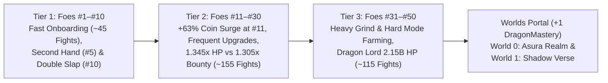

# These Hands — Game Design & Economy Bible (v3.1 — Post-Monkey Coin Surge & Grind Calibration)
*Implementation-Ready Reference Guide for Combat Balance, Continuous Coin Scaling, Smoothed Leveling Curves, and Endgame Progression*

---

## 1. Executive Summary & Why `v3.1` Solves Post-Monkey Stagnation

In `v3.0`, players hit a frustrating wall immediately after defeating **#10 Mischievous Monkey**: cutting mid-fight slap coin ratios at Stage `#11` caused total fight payouts to stagnate (`1,732` coins on `#10` vs. `1,712` coins on `#11`) right as Player Level-Up costs (`42,000` at Lv 10) and Stage 2 attribute prices (`1.35` exponent) spiked sharply.

`v3.1` resolves this bottleneck so players **always feel richer and upgrade frequently**, while preserving a **challenging ~315-fight Mortal Realm grind** that relies on Hard Mode farming at boss walls:

1. **Immediate `+63%` Post-Monkey Payout Surge:**
   - **#11 Bodybuilder** jumps from `737` bounty (`~1,732` total payout on `#10`) to **`1,150` bounty (`~2,818` total payout)**, and payouts increase steeply across every single stage up to **`309,917,141` base bounty** on **#50 Dragon Lord**.
2. **Continuous Slap Coin Fountains (No Stage `#11` Cliff):**
   - `Base Slap Coin` remains at **`5.5%` of Bounty** with a **`1.15x` fight cap** across `#11–#50` (instead of dropping to `4%` / `0.80x`), ensuring every hit on tougher enemies yields visibly larger floating coin fountains.
3. **Smoothed Player Level-Up & Stage 2 Cost Curves (`Lv 6–25`):**
   - Player Level-Up costs scale smoothly (`1.75x` for Lv `1–9`, starting at **`18,500`** at Lv `10` with a **`1.28x`** multiplier) and Stage 2 Attribute pricing uses a **`1.29`** exponent—letting players purchase upgrades every **$2$–$5$ fights** instead of stalling for $25+$ fights behind a single level gate.
4. **High Challenge Preserved via Faster Enemy HP Scaling (`1.345x` / `1.475x`) & Controlled `Power` DPS:**
   - Tier 2 Enemy HP grows at **$1.345\times$/stage** (vs. $1.305\times$ Bounty) and Tier 3 Enemy HP grows at **$1.475\times$/stage** (vs. $1.435\times$ Bounty), while `Power` scales at $(10 + 2.2 \times \text{lvl}) \times 1.076^{\text{lvl}} \times 1.28^{\lfloor \text{lvl}/10 \rfloor}$. Because Enemy HP outpaces raw Normal-mode coin growth, players still hit exciting boss walls that require **Hard Mode (`4.75x` KO jackpot)** farming, **Guard** blocks, and **Deflect** parries.
5. **Anti-Permastun & Sustain Caps:**
   - Enemies gain **`2.5s` of Stun/Daze immunity** after recovering from any stun, stuns **pause** rather than reset the enemy attack bar, Mini-Bosses/Bosses have **`50%` Stun duration tenacity**, and percent-HP sustain is capped so enemy attacks stay lethal.



---

## 2. Combat & Coin Earning System

### 2.1 Continuous Slap Coin Generation (Normal Mode)
In Normal Mode, every slap landed on an enemy generates instant battle coins *(Hard Mode disables per-slap coins in favor of a $4.75\times$ KO jackpot; see Section 3.3)*:

$$\text{Base Slap Coin}(i) = \max\left(1, \text{round}\left(\text{Bounty}(i) \times \text{BaseFrac}(i)\right)\right)$$

$$\text{BaseFrac}(i) = \begin{cases} 0.070 & \text{if } 1 \le i \le 10 \\ 0.055 & \text{if } 11 \le i \le 50 \end{cases}$$

$$\text{Bonus Fraction} = \min\left(1.0, \frac{\text{Damage Dealt}}{\max(1, \text{Enemy HP})} \times 4\right)$$

$$\text{Initial Gain} = \max\left(1, \text{round}\left(\text{Base Slap Coin} \times (1 + \text{Bonus}) \times \text{StageMult}(i) \times \text{CoinMult}\right)\right)$$

#### Stage Multipliers (1-Indexed Enemy Number $i \in [1, 50]$):
* **Enemies #1 – #10 (Tier 1):** `slapEarlyMult` $= 2.20\times$ ($1.65\times$ for bosses).
* **Enemies #11 – #30 (Tier 2):** `slapMidMult` $= 1.50\times$ ($1.20\times$ for bosses).
* **Enemies #31 – #50 (Tier 3):** `slapLateMult` $= 1.35\times$ ($1.10\times$ for bosses).
* **Critical Hit Bonus:** Adds $+35\%$ extra slap coins on crit (`critPayFrac: 0.35`).
* **Fortune Luck Bonus:** Lucky slaps multiply slap coin earnings by $2.5\times$ (`luckCoinMult: 2.5`).

#### Fight Slap Coin Cap & Soft Taper:
* **Fight Cap:** For Enemies #1–#10, total slap coins collected in a single fight cap at **$175\%$ of the enemy's kill bounty** (`slapEarlyCapFrac: 1.75`). For Enemies #11–#50, total slap coins cap at **$115\%$** (`slapFightCapFrac: 1.15`).
* **Taper:** Once accumulated fight hit coins reach the cap, additional slaps continue paying at a **$25\%$ rate** (`slapTaperFrac: 0.25`) so prolonged fights and productive losses remain rewarding.

---

### 2.2 Decoupled Enemy Bounty & First-Clear Boss Chests
In `v3.1`, **Kill Bounty is decoupled from Enemy HP** and stored in its own static array (`ENEMY_BOUNTY[50]`). Payouts grow steeply and strictly monotonically from `#1` (`30`) to `#50` (`309,917,141`), while Enemy HP grows faster in Tier 2 (`1.345x` vs `1.305x`) and Tier 3 (`1.475x` vs `1.435x`).

* **Normal Kill Payout:** Awards `1.30x Bounty` (`+30%` KO bonus) + accumulated mid-fight slap coins.
* **Hard Mode Payout:** Hard Mode uses the **exact same enemy** with boosted stats, awards **$0$ per-slap coins** and **$0$ coins on defeat**, and grants **`4.75x Bounty`** upon victory (`CONFIG.hard.coinMult: 4.75`), $+5\text{ Gems}$ on first clear, and $1.5\times$ Soul Embers.
* **Group Reward Bonus:** Defeating all 5 enemies in a group awards an immediate lump sum equal to **$1.0\times$ the group's total bounty**.
* **One-Time Boss & Mini-Boss First-Clear Chests:**

| Boss / Mini-Boss | First-Clear Bonus Coins | First-Clear Gems | Milestone Unlock |
|---|---|---|---|
| **#5 Grumpy Teddy** *(Mini-Boss)* | $+200$ | $+2\text{ Gems}$ | Unlocks **Second Hand** (`1,200` coins) |
| **#10 Mischievous Monkey** *(Boss)* | $+1,850$ | $+5\text{ Gems}$ | Unlocks **Double Slap** Special & **Twin Mastery** |
| **#15 Sumo Champion** *(Mini-Boss)* | $+6,500$ | $+2\text{ Gems}$ | Unlocks Group 4 (*Dojo Masters*) |
| **#20 Grandmaster Shin** *(Boss)* | $+32,000$ | $+5\text{ Gems}$ | Unlocks **Boss Hunter** Skill |
| **#25 Syndicate Boss** *(Mini-Boss)* | $+110,000$ | $+2\text{ Gems}$ | Unlocks Group 6 (*Cyber Underground*) |
| **#30 Neon Overlord** *(Boss)* | $+450,000$ | $+5\text{ Gems}$ | Unlocks **Guard** Special & **Kinetic Barrier** |
| **#35 Pharaoh King** *(Mini-Boss)* | $+2,500,000$ | $+3\text{ Gems}$ | Unlocks Group 8 (*Shadow Syndicate*) |
| **#40 Shadow Overlord** *(Boss)* | $+16,500,000$ | $+5\text{ Gems}$ | Unlocks **Uppercut Punch** Special & **Colossus Bane** |
| **#45 Titan Colossus** *(Mini-Boss)* | $+90,000,000$ | $+3\text{ Gems}$ | Unlocks Group 10 (*Dragon Lair*) |
| **#50 Dragon Lord** *(Final Boss)* | $+650,000,000$ | $+10\text{ Gems}$ | Grants **`+1 DragonMastery`**, unlocks Player Lv `36–50` & **Worlds Portal** |

---

## 3. Enemy Health, Damage, Bounty & Anti-Permastun Rules

### 3.1 Decoupled Scaling Architecture (`ENEMY_HP[50]`, `ENEMY_DMG[50]`, `ENEMY_BOUNTY[50]`)
* **Tier 1 (`#1–#10`):** Fast onboarding curve culminating in `#10 Mischievous Monkey` (`2,415 HP`, `54 Dmg`, `737 Bounty`).
* **Tier 2 (`#11–#30`):** Base HP scales at **$1.345\times$/stage** while Base Bounty scales at **$1.305\times$/stage** (starting `#11 Bodybuilder` at `4,150 HP` and `1,150 Bounty`—a `+63%` total payout jump over `#10 Monkey`), with controlled Mini-Boss and Boss multipliers so post-boss openers strictly exceed the previous Boss.
* **Tier 3 (`#31–#50`):** Base HP scales at **$1.475\times$/stage** while Base Bounty scales at **$1.435\times$/stage**, culminating in **#50 Dragon Lord at `2,150,000,000 HP` (`2.15B`), `4,650 Dmg`, and `309,917,141 Bounty`**.
* **Attack Interval Formula:**

$$\text{Interval}(i) = \max\left(1.40\text{s}, 2.40\text{s} \times 0.988^{i - 1}\right)$$

---

### 3.2 Complete 50-Enemy Roster Table (`v3.1` Exact Lookup Values)

| # | Enemy Name | Role | Health (HP) | Attack Dmg | Interval | Kill Bounty | Group |
|---|---|---|---|---|---|---|---|
| **1** | Training Dummy | Standard | **65** | 8 | 2.40s | **30** | Group 1: Backyard Brawl |
| **2** | Rubber Duck | Standard | **97** | 12 | 2.35s | **30** | Group 1: Backyard Brawl |
| **3** | Rubber Chicken | Standard | **145** | 15 | 2.30s | **36** | Group 1: Backyard Brawl |
| **4** | Cardboard Knight | Standard | **220** | 20 | 2.25s | **55** | Group 1: Backyard Brawl |
| **5** | Grumpy Teddy | **Mini-Boss** | **363** | 26 | 2.05s | **88** | Group 1: Backyard Brawl |
| **6** | Sassy Goblin Sprout | Standard | **455** | 28 | 2.20s | **109** | Group 2: Playpen Outlaws |
| **7** | Mime | Standard | **638** | 32 | 2.15s | **151** | Group 2: Playpen Outlaws |
| **8** | Cocky Goose | Standard | **893** | 38 | 2.10s | **208** | Group 2: Playpen Outlaws |
| **9** | Trash Panda | Elite | **1,303** | 46 | 2.05s | **299** | Group 2: Playpen Outlaws |
| **10** | Mischievous Monkey | **Boss** | **2,415** | 54 | 1.95s | **737** | Group 2: Playpen Outlaws |
| **11** | Bodybuilder | Standard | **4,150** | 64 | 2.13s | **1,150** | Group 3: Gym Rats |
| **12** | Luchador Wrestler | Standard | **5,582** | 72 | 2.10s | **1,501** | Group 3: Gym Rats |
| **13** | Kickboxer | Standard | **7,507** | 81 | 2.08s | **1,958** | Group 3: Gym Rats |
| **14** | Adult Boxer | Standard | **10,098** | 91 | 2.05s | **2,556** | Group 3: Gym Rats |
| **15** | Sumo Champion | **Mini-Boss** | **16,297** | 138 | 2.03s | **3,736** | Group 3: Gym Rats |
| **16** | Karate Kid | Standard | **18,267** | 115 | 2.00s | **4,353** | Group 4: Dojo Masters |
| **17** | Black Belt Sensei | Standard | **24,569** | 130 | 1.98s | **5,680** | Group 4: Dojo Masters |
| **18** | Drunken Master | Standard | **33,045** | 146 | 1.95s | **7,413** | Group 4: Dojo Masters |
| **19** | Shaolin Monk | Elite | **49,779** | 222 | 1.93s | **10,254** | Group 4: Dojo Masters |
| **20** | Grandmaster Shin | **Boss** | **77,713** | 305 | 1.84s | **15,780** | Group 4: Dojo Masters |
| **21** | Bouncer | Standard | **80,403** | 208 | 1.88s | **16,474** | Group 5: Alleyway Syndicate |
| **22** | Street Punk | Standard | **108,142** | 234 | 1.86s | **21,499** | Group 5: Alleyway Syndicate |
| **23** | Thug Enforcer | Standard | **145,451** | 263 | 1.84s | **28,056** | Group 5: Alleyway Syndicate |
| **24** | Knuckle Brawler | Standard | **195,631** | 296 | 1.82s | **36,613** | Group 5: Alleyway Syndicate |
| **25** | Syndicate Boss | **Mini-Boss** | **315,749** | 449 | 1.79s | **53,513** | Group 5: Alleyway Syndicate |
| **26** | Cyberpunk Grunt | Standard | **353,901** | 375 | 1.77s | **62,353** | Group 6: Cyber Underground |
| **27** | Neon Assassin | Standard | **475,997** | 421 | 1.75s | **81,370** | Group 6: Cyber Underground |
| **28** | Mech Soldier | Standard | **640,217** | 474 | 1.73s | **106,188** | Group 6: Cyber Underground |
| **29** | Chrome Juggernaut | Elite | **964,422** | 720 | 1.71s | **146,890** | Group 6: Cyber Underground |
| **30** | Neon Overlord | **Boss** | **1,505,618** | 990 | 1.63s | **226,052** | Group 6: Cyber Underground |
| **31** | Stone Golem | Standard | **1,708,298** | 663 | 1.67s | **259,507** | Group 7: Ancient Ruins |
| **32** | Desert Guardian | Standard | **2,519,739** | 732 | 1.65s | **372,393** | Group 7: Ancient Ruins |
| **33** | Cursed Mummy | Standard | **3,716,615** | 809 | 1.63s | **534,384** | Group 7: Ancient Ruins |
| **34** | Anubis Warrior | Standard | **5,482,007** | 894 | 1.61s | **766,841** | Group 7: Ancient Ruins |
| **35** | Pharaoh King | **Mini-Boss** | **9,703,152** | 1,334 | 1.59s | **1,232,466** | Group 7: Ancient Ruins |
| **36** | Shadow Ninja | Standard | **11,926,791** | 1,092 | 1.57s | **1,579,098** | Group 8: Shadow Syndicate |
| **37** | Dark Assassin | Standard | **17,592,017** | 1,207 | 1.55s | **2,266,005** | Group 8: Shadow Syndicate |
| **38** | Shadow Weaver | Standard | **25,948,225** | 1,333 | 1.53s | **3,251,717** | Group 8: Shadow Syndicate |
| **39** | Void Walker | Elite | **42,866,468** | 1,989 | 1.51s | **4,946,187** | Group 8: Shadow Syndicate |
| **40** | Shadow Overlord | **Boss** | **73,389,690** | 2,686 | 1.44s | **8,370,022** | Group 8: Shadow Syndicate |
| **41** | Frost Giant | Standard | **83,269,072** | 1,799 | 1.48s | **9,608,785** | Group 9: Titan Peaks |
| **42** | Mountain Colossus | Standard | **122,821,881** | 1,988 | 1.46s | **13,788,606** | Group 9: Titan Peaks |
| **43** | Magma Titan | Standard | **181,162,274** | 2,197 | 1.44s | **19,786,650** | Group 9: Titan Peaks |
| **44** | Tempest Giant | Standard | **267,214,354** | 2,427 | 1.42s | **28,393,843** | Group 9: Titan Peaks |
| **45** | Titan Colossus | **Mini-Boss** | **472,969,407** | 3,621 | 1.40s | **45,634,585** | Group 9: Titan Peaks |
| **46** | Elder Dragon | Standard | **581,358,229** | 2,964 | 1.40s | **58,469,311** | Group 10: Dragon Lair |
| **47** | Dragon Champion | Standard | **857,503,388** | 3,275 | 1.40s | **83,903,462** | Group 10: Dragon Lair |
| **48** | Crystal Dragon | Standard | **1,264,817,497** | 3,619 | 1.40s | **120,401,468** | Group 10: Dragon Lair |
| **49** | Ancient Dragon | Elite | **1,820,000,000** | 5,399 | 1.40s | **183,142,673** | Group 10: Dragon Lair |
| **50** | Dragon Lord | **Final Boss** | **2,150,000,000** | 4,650 | 1.40s | **309,917,141** | Group 10: Dragon Lair |

---

### 3.3 Hard Mode Scaling & High-Stakes Grind Loop
Hard Mode uses the **exact same 50 enemies** (same names, visuals, and Group Signature Moves) once their Normal Mode stage has been cleared:

* **`hpMult: 1.75` ($1.75\times$ Normal HP) & `dmgMult: 1.25` ($1.25\times$ Normal Damage)**
* **`intervalMult: 1.00` (Unchanged Attack Interval)**
* **`coinMult: 4.75` ($4.75\times$ `ENEMY_BOUNTY[i]` on Victory, `noSlapCoins: true`):** Drops **$0$ coins per slap** and **$0$ coins on defeat**, paying a lump-sum jackpot upon victory (`~1.94x` higher total payout than a Normal Mode clear in Tier 2/3, serving as the primary farming engine at boss walls).
* **Group Mastery Bonus:** Clearing all 5 enemies in a group on Hard Mode awards **$+15\text{ Gems}$** and a **permanent $+2\%$ global Coin Multiplier**.

---

### 3.4 Anti-Permastun Mechanics & Group Combat Archetypes

#### Anti-Permastun Rules:
1. **Stun Immunity Window (`stunImmunitySec: 2.5`):** Whenever any enemy recovers from a Stun or Daze (`Stun` attribute, `Seismic Slam`, or `Godhand Awakening`), they gain **$2.5\text{s}$ of complete Stun/Daze immunity**, guaranteeing they execute at least one attack cycle between stuns.
2. **Timer Pause (Not Reset):** Stunning an enemy **pauses** their attack swing bar for the stun duration instead of resetting it back to $0.0\text{s}$.
3. **Boss Tenacity (`bossStunDurationMult: 0.50`):** All Mini-Bosses and Chapter Bosses reduce incoming Stun/Daze durations by **$50\%$** (except `Uppercut Punch`'s fixed $3.0\text{s}$ stun).

#### Group Signature Moves (Triggered Every 3rd Enemy Attack in Groups 3–10):
* **G3 Gym Rats:** *Haymaker Knockback* (resets player Combo stacks to $0$).
* **G4 Dojo Masters:** *Iron Guard Stance* ($-30\%$ incoming slap damage for $2.0\text{s}$).
* **G5 Alleyway Syndicate:** *Sucker Punch* ($1.4\times$ damage + **Daze**: $-15\%$ slap speed for $2.5\text{s}$).
* **G6 Cyber Underground:** *EMP Pulse* (**Specials Lock** for $3.0\text{s}$).
* **G7 Ancient Ruins:** *Sands of Torpor* (**Slow**: $-25\%$ slap speed for $3.5\text{s}$).
* **G8 Shadow Syndicate:** *Shadow Veil* ($+15\%$ enemy dodge for $2.5\text{s}$; $\text{Effective Hit Chance} = \max(50\%, \text{Player Accuracy} - 15\%)$).
* **G9 Titan Peaks:** *Magma Slam* (**Burn DoT**: $3\%$ Player Max HP/sec for $3.0\text{s}$).
* **G10 Dragon Lair:** *Dragonfire Breath* ($1.5\times$ damage + **Burn DoT**: $4\%$ Player Max HP/sec for $3.0\text{s}$).

---

## 4. Attribute Upgrade Structure & Pricing Curves (`v3.1`)

### 4.1 Attribute Configuration Table

| Attribute Key | Display Name | Base Cost | Max Cost | Max Level ($N$) | Effect per Level | Hard Cap |
|---|---|---|---|---|---|---|
| `power` | Power | 60 | **45,000,000,000** | 80 | **$(10 + 2.2 \times \text{lvl}) \times 1.076^{\text{lvl}} \times 1.28^{\lfloor \text{lvl}/10 \rfloor}$** | Lv 71–80 gated behind Portal |
| `speed` | Speed | 110 | 75,000,000 | 40 | $\times 0.98114$ Attack Interval | $0.70\text{s}$ base floor ($0.35\text{s}$ w/ skills) |
| `critChance` | Crit Chance | 130 | 85,000,000 | 55 | $+1.0\%$ Critical Strike Chance | $75.0\%$ cap |
| `critDamage` | Crit Damage | 90 | 65,000,000 | 65 | **$+5.0\%$ Critical Strike Multiplier** | No cap |
| `defense` | Defense | 220 | 95,000,000 | 40 | $+1.0\%$ Damage Reduction | $40.0\%$ cap |
| `stun` | Stun | 130 | 80,000,000 | 50 | $+0.5\%$ Stun Chance & $+0.02\text{s}$ Duration | $25\%$ chance / $1.4\text{s}$ duration |
| `combo` | Combo | 75 | 60,000,000 | 65 | $+1.0\%$ Dmg per Stack & $+0.4$ Cap | Base $4$ stacks |
| `coinMult` | Coin Mult. | 80 | 65,000,000 | 65 | $+5.0\%$ All Coin Earnings | No cap |
| `accuracy` | Accuracy | 95 | 30,000,000 | 14 | $+1.0\%$ Slap Hit Chance | $99.0\%$ cap |
| `bossDamage` | Giant Slayer | 220 | 95,000,000 | 40 | $+1.5\%$ Damage vs Elites, Mini-Bosses & Bosses | $60.0\%$ cap |
| `vampirism` | Life Leech | 380 | 150,000,000 | 40 | **$+0.08\%$ of Player Max HP healed every 8th Slap** | **$3.2\%$ Max HP / 8th slap** |
| `luck` | Fortune Luck | 140 | 85,000,000 | 50 | $+0.5\%$ Lucky Slap Chance | $25.0\%$ cap |

---

### 4.2 Smoothed Dynamic 3-Stage Pricing Formula (`1.56` / `1.29` Exponents)

$$T = \min\left(25, \left\lfloor 0.5 \times N \right\rfloor\right), \quad S_1 = \min(9, T - 1)$$

$$\text{Cost}(\text{key}, \text{lvl}) = \begin{cases}
\text{round}\left(\text{base} \times 1.56^{\text{lvl}}\right) & \text{if } \text{lvl} \le S_1 \\[6pt]
\text{round}\left(\text{cost}_{S_1} \times 1.29^{\text{lvl} - S_1}\right) & \text{if } S_1 < \text{lvl} \le T \\[6pt]
\text{round}\left(\text{cost}_{T} \times \left(\frac{\text{maxCost}}{\text{cost}_{T}}\right)^{\frac{\text{lvl} - T}{N - 1 - T}}\right) & \text{if } T < \text{lvl} < N \\[6pt]
\infty & \text{if } \text{lvl} \ge N
\end{cases}$$

#### Milestone Cost Comparison Table (Exact Formula Outputs):

| Level | Power Cost ($N=80$) | Speed Cost ($N=40$) | Accuracy Cost ($N=14$) | Defense Cost ($N=40$) | Life Leech Cost ($N=40$) |
|---|---|---|---|---|---|
| **Lv 0** | 60 | 110 | 95 | 220 | 380 |
| **Lv 1** | 94 | 172 | 148 | 343 | 593 |
| **Lv 5** | 554 | 1,016 | 878 | 2,033 | 3,511 |
| **Lv 9** | 3,283 | 6,019 | 45,510 | 12,038 | 20,793 |
| **Lv 10** | **4,235** | **7,765** | 231,030 | 15,529 | 26,823 |
| **Lv 13** | 9,091 | 16,668 | **30,000,000** | 33,335 | 57,579 |
| **Lv 14** | 11,727 | 21,502 | **MAX** | 43,002 | 74,277 |
| **Lv 20** | **53,996** | **98,996** | MAX | 197,991 | 341,985 |
| **Lv 25** | **192,971** | 567,380 | MAX | 1,038,240 | 1,750,820 |
| **Lv 30** | **606,120** | 3,251,850 | MAX | 5,444,400 | 8,963,400 |
| **Lv 39** | **4,752,300** | **75,000,000** | MAX | **95,000,000** | **150,000,000** |
| **Lv 40** | **5,978,940** | **MAX** | MAX | **MAX** | **MAX** |
| **Lv 50** | **58,977,900** | MAX | MAX | MAX | MAX |
| **Lv 60** | **581,774,000** | MAX | MAX | MAX | MAX |
| **Lv 70** | **5,738,770,000** | MAX | MAX | MAX | MAX |
| **Lv 79** | **45,000,000,000** | MAX | MAX | MAX | MAX |
| **Lv 80** | **MAX** | MAX | MAX | MAX | MAX |

---

## 5. Player Level Up System, Survivability & Passives (`v3.1`)

* **Smoothed Player Level-Up Cost Curve (Eliminates Post-Monkey Level Gate Stalls):**
  $$\text{LevelCost}(\text{plvl}) = \begin{cases}
  \text{round}\left(150 \times 1.75^{\text{plvl} - 1}\right) & \text{if } 1 \le \text{plvl} \le 9 \\[6pt]
  \text{round}\left(18,500 \times 1.28^{\text{plvl} - 10}\right) & \text{if } 10 \le \text{plvl} \le 25 \\[6pt]
  \text{round}\left(1,250,000 \times 1.24^{\text{plvl} - 26}\right) & \text{if } 26 \le \text{plvl} \le 45 \\[6pt]
  \text{round}\left(120,000,000 \times 1.26^{\text{plvl} - 46}\right) & \text{if } 46 \le \text{plvl} \le 50
  \end{cases}$$
  *(Checkpoints: Lv 1 = $150$, Lv 6 = $2,462$, Lv 9 = $13,195$, Lv 10 = $18,500$, Lv 15 = $63,560$, Lv 20 = $218,370$, Lv 25 = $750,240$, Lv 30 = $2,955,270$, Lv 35 = $8,663,800$).*
* **Player Max HP:**
  $$\text{HP}(\text{plvl}) = 100 + 25 \times (\text{plvl} - 1) + \text{round}\left(15 \times 1.16^{\text{plvl} - 1}\right)$$
  *(Checkpoints: Lv 1 = $115\text{ HP}$, Lv 10 = $382\text{ HP}$, Lv 20 = $827\text{ HP}$, Lv 30 = $1,935\text{ HP}$, Lv 35 = $3,270\text{ HP}$, Lv 40 = $5,969\text{ HP}$, Lv 45 = $11,488\text{ HP}$).*
* **Attribute Level Gate:**
  $$\text{Gate} = (\text{PlayerLevel} \times 2) + (\text{DragonMastery} \times 5)$$
  * `PlayerLevel` is capped at **`35`** (`Gate = 70`) in the Mortal Realm.
  * Defeating **#50 Dragon Lord** grants `DragonMastery = 1` (`Gate = 75` in *Asura Realm*), and defeating **W0 S5 (*Ten-King Asura*)** grants `DragonMastery = 2` (`Gate = 80` in *Shadow Verse*).
* **Rebalanced Sustain & Passive Highlights:**
  * **Lv 2 *Iron Palm*:** $+25\%$ slap damage.
  * **Lv 3 *Quickening*:** $+10\%$ slap speed.
  * **Lv 4 *Thick Skin*:** $-15\%$ incoming damage.
  * **Lv 5 *Greed*:** $+20\%$ coins from all sources.
  * **Lv 6 *Vampire Slap*:** Every **10th slap** heals **$1.0\%$ of Max HP** (min $10\text{ HP}$).
  * **Lv 7 *Crit Surge*:** $+8\%$ critical strike chance.
  * **Lv 8 *Second Wind*:** Once per fight, recover **$30\%$ Max HP** upon fatal blow *(1st in revive priority)*.
  * **Lv 9 *Boss Bane*:** $+25\%$ damage vs Group Elites, Mini-Bosses, and Bosses.
  * **Lv 10 *Golden Aura*:** $+30\%$ coins earned.
  * **Lv 18 *Iron Resolve*:** Every **25th slap** cleanses all debuffs (*Burn, Slow, Daze, Specials Lock*) and heals **$4.0\%$ of Max HP**.
  * **Lv 20 *Godhand Awakening*:** Every 30th slap deals $3\times$ damage and stuns for $1.5\text{s}$ (subject to Boss Tenacity and $2.5\text{s}$ stun immunity).

---

## 6. Skills Tree, Specials & Worlds Portal (`W0 S0`–`W1 S5`)

### 6.1 Key Skill & Special Milestones
* **#5 Grumpy Teddy (`1,200` coins):** Unlocks **Second Hand** (alternates Left and Right hands, doubling slap cadence within the first few minutes).
* **#10 Mischievous Monkey (`10,000` coins / Boss Clear):** Unlocks **Twin Mastery** ($+25\%$ off-hand slap speed) and the **Double Slap** Special ($4\times \to 10\times$ instant damage; upgrades `15k, 85k, 450k, 2.4M`).
* **Deflect (`65,000` coins):** Spawns a parry ring on all Mini-Boss, Elite, Chapter Boss, and 3rd-attack Group Signature Moves (`1.5s` internal spawn cooldown); tap on time to negate $100\%$ of incoming damage.
* **#30 Neon Overlord (Boss Clear):** Unlocks **Guard** Special ($100\%$ damage block for $1 \to 3$ hits; upgrades `25M, 150M`) and **Kinetic Barrier** (`68M`).
* **#40 Shadow Overlord (Boss Clear):** Unlocks **Uppercut Punch** Special ($18\times \to 32\times$ damage + $3.0\text{s}$ stun; upgrades `35M, 110M, 320M, 900M`).

---

### 6.2 Worlds Portal (`W0 S0`–`W1 S5`), Soul Embers & Relics

World Portal stages scale continuously above **#50 Dragon Lord** (`2.15B HP` / `4,650 Dmg` / `309.92M Bounty`), funding the final `Power` Levels `71–80` (`45B` max cost) while keeping repeat coin payouts strictly monotonic:

| Stage | Guardian Name | Role | Health (HP) | Attack Dmg | Interval | Repeat Bounty | Embers (1st / Repeat) | Relic Dropped (1-Star) |
|---|---|---|---|---|---|---|---|---|
| **W0 S0** | Asura Vanguard | Standard | **3,100,000,000** | 5,200 | 1.38s | **365,000,000** | $+3$ / $+1$ | 🔔 Bronze War Bell |
| **W0 S1** | Rakshasa Bloodblade | Standard | **4,550,000,000** | 5,800 | 1.36s | **525,000,000** | $+4$ / $+1$ | 🗡️ Rakshasa Fang |
| **W0 S2** | Dusk Bellkeeper | Mini-Boss | **6,700,000,000** | 6,600 | 1.35s | **755,000,000** | $+5$ / $+2$ | 🔔 Slumber Bell |
| **W0 S3** | Stampede Warlord | Standard | **9,850,000,000** | 7,400 | 1.34s | **1,085,000,000** | $+5$ / $+2$ | 📯 Horn of the Stampede |
| **W0 S4** | Whispering Skull-Lich | Elite | **14,500,000,000** | 8,450 | 1.32s | **1,560,000,000** | $+6$ / $+2$ | 💀 Skull of Whispers |
| **W0 S5** | **Ten-King Asura** | **World Boss** | **21,500,000,000** | 9,900 | 1.30s | **2,850,000,000** | $+10$ / $+3$ | 👑 Crown of Ten Kings |
| **W1 S0** | Hollow Firstborn | Standard | **31,500,000,000** | 11,000 | 1.30s | **3,250,000,000** | $+6$ / $+2$ | 🪵 Splinter of the First Foe |
| **W1 S1** | Silent Shade | Standard | **46,500,000,000** | 12,300 | 1.28s | **4,680,000,000** | $+7$ / $+3$ | 🧤 Silent Glove |
| **W1 S2** | Void Marionette | Mini-Boss | **68,500,000,000** | 13,900 | 1.26s | **6,750,000,000** | $+8$ / $+3$ | 🎭 Puppet Strings |
| **W1 S3** | Venomfang Naga | Standard | **101,000,000,000** | 15,600 | 1.25s | **9,720,000,000** | $+9$ / $+4$ | 🐍 Venomfang Coil |
| **W1 S4** | Void Ascendant | Elite | **149,000,000,000** | 17,800 | 1.24s | **14,000,000,000** | $+10$ / $+5$ | 📿 Beads of the Void |
| **W1 S5** | **Mirror God of the Void** | **World Boss** | **225,000,000,000** | 21,200 | 1.22s | **28,500,000,000** | $+15$ / $+6$ | 🪞 Mirror Palm |

* **Deterministic Relic Ascension:** `1-Star` drops on First Clear; `2-Star` requires `3 Repeat Clears + 10 Soul Embers`; `3-Star` requires `8 Repeat Clears + 25 Soul Embers` (`420 Embers` total across all 12 Relics + `165 Embers` for all 8 World Arts = `585 Total Embers`).
* **Sequential Revive Order:** `1. Second Wind` ($30\%$ Max HP) $\to$ `2. Phoenix Heart` ($25\%$ Max HP + $1.5\text{s}$ immunity) $\to$ `3. Boss Revive` Rewarded Ad ($50\%$ Max HP + specials refreshed).

---

## 7. Ads Cadence & Monetization Rules

* **Interstitial Ads:** Trigger at **`3.0 Fight Points`** with a **`75s` minimum cooldown** (`+1.0` per victory, `+0.5` per Normal loss, and `+0.0` on Hard Mode losses). Combat timers pause while ads are displayed.
* **Rewarded Ads:** $2\times$ Battle Coins (`10m`), $2\times$ Battle Damage (`10m`), End-of-Fight Doubler (doubles full Normal haul or Hard Mode $4.75\times$ KO jackpot), and Boss Revive.

---

## 8. Ready-to-Paste `BALANCE_V3_1` Config (JavaScript)

```javascript
export const BALANCE_V3_1 = {
  // 1-indexed Stage #1 to #50 (strictly monotonic HP & Bounty)
  ENEMY_HP: [
    65, 97, 145, 220, 363, 455, 638, 893, 1303, 2415,
    4150, 5582, 7507, 10098, 16297, 18267, 24569, 33045, 49779, 77713,
    80403, 108142, 145451, 195631, 315749, 353901, 475997, 640217, 964422, 1505618,
    1708298, 2519739, 3716615, 5482007, 9703152, 11926791, 17592017, 25948225, 42866468, 73389690,
    83269072, 122821881, 181162274, 267214354, 472969407, 581358229, 857503388, 1264817497, 1820000000, 2150000000
  ],
  ENEMY_DMG: [
    8, 12, 15, 20, 26, 28, 32, 38, 46, 54,
    64, 72, 81, 91, 138, 115, 130, 146, 222, 305,
    208, 234, 263, 296, 449, 375, 421, 474, 720, 990,
    663, 732, 809, 894, 1334, 1092, 1207, 1333, 1989, 2686,
    1799, 1988, 2197, 2427, 3621, 2964, 3275, 3619, 5399, 4650
  ],
  ENEMY_BOUNTY: [
    30, 30, 36, 55, 88, 109, 151, 208, 299, 737,
    1150, 1501, 1958, 2556, 3736, 4353, 5680, 7413, 10254, 15780,
    16474, 21499, 28056, 36613, 53513, 62353, 81370, 106188, 146890, 226052,
    259507, 372393, 534384, 766841, 1232466, 1579098, 2266005, 3251717, 4946187, 8370022,
    9608785, 13788606, 19786650, 28393843, 45634585, 58469311, 83903462, 120401468, 183142673, 309917141
  ],

  // Continuous Slap Coin Economy (no harsh drop at Stage #11)
  slapCoin: {
    earlyBaseFrac: 0.07,    // Stages #1-#10
    midLateBaseFrac: 0.055, // Stages #11-#50
    slapEarlyMult: 2.2,
    slapMidMult: 1.5,
    slapLateMult: 1.35,
    slapEarlyCapFrac: 1.75,
    slapFightCapFrac: 1.15,
    slapTaperFrac: 0.25,
    critPayFrac: 0.35,
    luckCoinMult: 2.5
  },

  combat: {
    stunImmunitySec: 2.5,
    bossStunDurationMult: 0.50,
    stunResetsSwingTimer: false,
    normalKoBonusMult: 1.30,
    groupClearBonusMult: 1.00
  },

  hard: {
    hpMult: 1.75,
    dmgMult: 1.25,
    intervalMult: 1.00,
    coinMult: 4.75,
    noSlapCoins: true
  },

  // Smoothed Attribute Pricing & Restrained Power Efficiency
  pricing: {
    stage1Exp: 1.56,          // Lv 0 -> S1
    stage2Exp: 1.29,          // S1+1 -> T (prevents mid-game cost explosion)
    powerMaxCost: 45_000_000_000,
    powerBaseFlat: 10,
    powerBaseSlope: 2.2,
    powerGrowthExp: 1.076,
    powerMilestoneMult: 1.28, // Every 10 levels
    critDmgPerLvl: 0.05,
    vampirismPctPerLvl: 0.0008,
    vampirismSlapInterval: 8,
    mortalMaxPlayerLevel: 35
  },

  // Smoothed Player Level-Up Curve (1-indexed plvl)
  getPlayerLevelCost(plvl) {
    if (plvl <= 9) return Math.round(150 * Math.pow(1.75, plvl - 1));
    if (plvl <= 25) return Math.round(18500 * Math.pow(1.28, plvl - 10));
    if (plvl <= 45) return Math.round(1_250_000 * Math.pow(1.24, plvl - 26));
    return Math.round(120_000_000 * Math.pow(1.26, plvl - 46));
  }
};
```