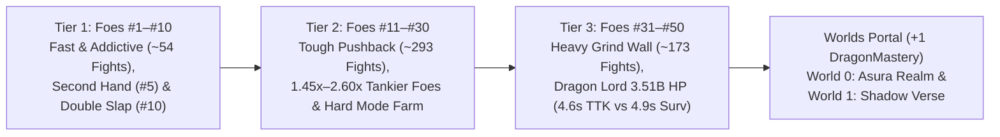

# These Hands — Game Design & Economy Bible (v3.0 — Calibrated Grind & Anti-Snowball Patch)
*Implementation-Ready Reference Guide for Combat Balance, Decoupled Economy Scaling, Stun/Sustain Caps, and Progression Systems*

---

## 1. Executive Summary & Why `v3.0` Calibrated Fixes the Difficulty Curve

In `v2.2`, flat enemy buffs (`+50%` HP / `+30%` damage) felt too easy because **Kill Bounty and Slap Coins scaled 1:1 with Enemy HP** (canceling out HP buffs with extra player upgrades), **mid-fight slap coins generated $200\%\text{–}300\%$ of kill bounty** (funding 1-pass clears with zero grinding), and **uncapped stun durations permastunned bosses** before they could attack.

`v3.0` (Calibrated) resolves all five bottlenecks while preserving a **snappy, addictive Tier 1 (#1–#10)** and a **beatable yet razor-thin `#50 Dragon Lord` climax** at the Mortal Realm cap (`Power Lv 70 / Player Lv 35`):

1. **Decoupled HP vs. Bounty Scaling (Sub-Linear Coin Economy):**
   - Repeat coin payouts **strictly increase from #1 (`30`) to #50 (`301,158,000`)** so players always earn more as they advance.
   - **Enemy HP is decoupled from Bounty** and scales progressively from `1.00x–1.15x` (Tier 1) $\to$ `1.45x–2.60x` (Tier 2) $\to$ `2.80x–4.50x` (Tier 3, capping `#50 Dragon Lord` at **`3.51 Billion HP`**). Enemies grow progressively tankier per coin earned without creating an unkillable brick wall at Lv 70.
2. **Tier-Calibrated Mid-Fight Slap Coin Economy:**
   - **Tier 1 (#1–#10)** retains generous slap payouts (`7%` of Bounty, `2.2x` mult) so players clear Group 1–2 in ~54 fights with rapid-fire dopamine.
   - **Tier 2 (#11–#25)** tightens to `4%` of Bounty (`1.4x` mult, `90%` fight cap) and **Tier 3 (#26–#50)** tightens to `3.5%` of Bounty (`1.1x` mult, `85%` fight cap, `0.20` taper)—forcing multi-fight farming and **Hard Mode (`4.75x` KO jackpot)** runs to afford upgrades.
3. **Calibrated Player DPS Snowball & Mid-Game Cost Steepness:**
   - `Power` damage scales at `(10 + 2.5 * lvl) * (1.082 ** lvl) * (1.30 ** floor(lvl / 10))`, `Crit Damage` scales at **`+5%/lvl`**, and Stage 2 upgrade costs (`Lv 10–25`) steepen to **`1.35`**.
4. **Anti-Permastun Protection (`2.5s` Unstoppable Window):**
   - Enemies gain **`2.5s` of Stun/Daze immunity** after recovering from any stun, stuns **pause** rather than reset the enemy attack bar, and Mini-Bosses/Bosses have **`50%` Stun duration resistance**—guaranteeing enemies land their attacks.
5. **Rebalanced Percent-HP Sustain & Lethal Tier 2–3 Enemy Damage:**
   - Percent-HP healing is cut by ~55% across *Vampire Slap*, *Life Leech*, and *Iron Resolve*, while Tier 2/3 enemy damage scales at `1.122x` / `1.108x` per stage (with `#50 Dragon Lord` tuned to **`6,150` Attack Damage**)—forcing active use of **Defense**, **Guard**, and **Deflect** parry rings.



---

## 2. Combat & Coin Earning System

### 2.1 Slap Coin Generation (During Battle — Calibrated)
In Normal Mode, every hit landed on an enemy generates instant battle coins according to the calibrated `v3.0` formulas *(Hard Mode disables per-slap coins in favor of a $4.75\times$ KO jackpot; see Section 3.3)*:

$$\text{Base Slap Coin}(i) = \max\left(1, \text{round}\left(\text{Bounty}(i) \times \text{BaseFrac}(i)\right)\right)$$

$$\text{BaseFrac}(i) = \begin{cases} 0.070 & \text{if } 1 \le i \le 10 \\ 0.040 & \text{if } 11 \le i \le 25 \\ 0.035 & \text{if } 26 \le i \le 50 \end{cases}$$

$$\text{Bonus Fraction} = \min\left(1.0, \frac{\text{Damage Dealt}}{\max(1, \text{Enemy HP})} \times 4\right)$$

$$\text{Initial Gain} = \max\left(1, \text{round}\left(\text{Base Slap Coin} \times (1 + \text{Bonus}) \times \text{StageMult}(i) \times \text{CoinMult}\right)\right)$$

#### Stage Multipliers (1-Indexed Enemy Number $i \in [1, 50]$):
* **Enemies #1 – #10 (Tier 1):** `slapEarlyMult` $= 2.20\times$ ($1.65\times$ for bosses).
* **Enemies #11 – #25 (Tier 2):** `slapMidMult` $= 1.40\times$ ($1.10\times$ for bosses).
* **Enemies #26 – #50 (Tier 3):** `slapLateMult` $= 1.10\times$ ($0.90\times$ for bosses).
* **Critical Hit Bonus:** Adds $+35\%$ extra slap coins on crit (`slapCritPayFrac: 0.35`).
* **Fortune Luck Bonus:** Lucky slaps multiply slap coin earnings by $2.5\times$ (`luckCoinMult: 2.5`).

#### Fight Slap Coin Cap & Tightened Taper:
* **Fight Cap:** For Enemies #1–#10, total slap coins collected in a single fight cap at **$125\%$ of the enemy's kill bounty** (`slapEarlyCapFrac: 1.25`). For Enemies #11–#25, the cap is **$90\%$** (`slapMidCapFrac: 0.90`), and for Enemies #26–#50, total slap coins cap at **$85\%$** (`slapFightCapFrac: 0.85`).
* **Taper:** Once accumulated fight hit coins reach the cap, additional slaps pay at a **$20\%$ rate** (`slapTaperFrac: 0.20`), preventing long fights from inflating player wallets while still rewarding persistent boss attempts.

---

### 2.2 Decoupled Enemy Bounty & First-Clear Boss Chests
In `v3.0`, **Kill Bounty is decoupled from Enemy HP** and stored in its own static array (`ENEMY_BOUNTY[50]`). Every enemy strictly pays more than the previous enemy from `#1` (`30`) to `#50` (`301,158,000`), while Enemy HP scales up to $4.50\times$ faster in late game.

* **Normal Kill Payout:** Awards `1.20x Bounty` (`+20%` KO bonus) + accumulated mid-fight slap coins.
* **Hard Mode Payout:** Hard Mode uses the **exact same enemy** with boosted stats, awards **$0$ per-slap coins** and **$0$ coins on defeat**, and grants **`4.75x Bounty`** upon victory (`CONFIG.hard.coinMult: 4.75`), $+5\text{ Gems}$ on first clear, and $1.5\times$ Soul Embers.
* **Group Reward Bonus:** Defeating all 5 enemies in a group awards an immediate lump sum equal to **$1.0\times$ the group's total bounty**.
* **One-Time Boss & Mini-Boss First-Clear Chests:**

| Boss / Mini-Boss | First-Clear Bonus Coins | First-Clear Gems | Milestone Unlock |
|---|---|---|---|
| **#5 Grumpy Teddy** *(Mini-Boss)* | $+180$ | $+2\text{ Gems}$ | Unlocks **Second Hand** (1,200 coins) |
| **#10 Mischievous Monkey** *(Boss)* | $+1,500$ | $+5\text{ Gems}$ | Unlocks **Double Slap** Special & **Twin Mastery** |
| **#15 Sumo Champion** *(Mini-Boss)* | $+4,200$ | $+2\text{ Gems}$ | Unlocks Group 4 (*Dojo Masters*) |
| **#20 Grandmaster Shin** *(Boss)* | $+18,500$ | $+5\text{ Gems}$ | Unlocks **Boss Hunter** Skill |
| **#25 Syndicate Boss** *(Mini-Boss)* | $+50,000$ | $+2\text{ Gems}$ | Unlocks Group 6 (*Cyber Underground*) |
| **#30 Neon Overlord** *(Boss)* | $+220,000$ | $+5\text{ Gems}$ | Unlocks **Guard** Special & **Kinetic Barrier** |
| **#35 Pharaoh King** *(Mini-Boss)* | $+900,000$ | $+3\text{ Gems}$ | Unlocks Group 8 (*Shadow Syndicate*) |
| **#40 Shadow Overlord** *(Boss)* | $+5,500,000$ | $+5\text{ Gems}$ | Unlocks **Uppercut Punch** Special & **Colossus Bane** |
| **#45 Titan Colossus** *(Mini-Boss)* | $+24,000,000$ | $+3\text{ Gems}$ | Unlocks Group 10 (*Dragon Lair*) |
| **#50 Dragon Lord** *(Final Boss)* | $+600,000,000$ | $+10\text{ Gems}$ | Grants **`+1 DragonMastery`**, unlocks Player Lv `36–50` & **Worlds Portal** |

---

## 3. Enemy Health, Damage, Bounty & Anti-Permastun Rules

### 3.1 Scaling Formulas & Lookup Arrays (`ENEMY_HP[50]`, `ENEMY_DMG[50]`, `ENEMY_BOUNTY[50]`)
* **Progressive HP Tankiness Multiplier (Applied over `v2.2` Base HP while keeping Bounty static):**
  * **Tier 1 (#1–#10):** `1.00x` $\to$ `1.15x` (fast, snappy onboarding).
  * **Tier 2 (#11–#30):** $1.45 \times 1.031215^{i - 11}$ (`1.45x` at #11 $\to$ `2.60x` at #30).
  * **Tier 3 (#31–#50):** $2.80 \times 1.02529^{i - 31}$ (`2.80x` at #31 $\to$ `4.50x` at #50, placing **#50 Dragon Lord at `3,510,000,000 HP`**).
* **Calibrated Attack Damage Formula (`ENEMY_DMG[50]`):**

$$\text{Damage}(i) = \begin{cases} 
\text{earlyDmg}[i] & \text{if } 1 \le i \le 10 \\[4pt]
66 \times 1.122^{i - 11} & \text{if } 11 \le i \le 30 \\[4pt]
\left(66 \times 1.122^{19}\right) \times 1.108^{i - 30} & \text{if } 31 \le i \le 49 \\[4pt]
6,150 & \text{if } i = 50 \text{ (Dragon Lord)}
\end{cases} \times \begin{cases} 1.65 & \text{Boss } (i \in \{10, 20, 30, 40\}) \\ 1.35 & \text{Mini-Boss / Elite} \\ 1.00 & \text{Standard} \end{cases}$$

* **Attack Interval Formula:**

$$\text{Interval}(i) = \max\left(1.40\text{s}, 2.40\text{s} \times 0.988^{i - 1}\right)$$

---

### 3.2 Complete 50-Enemy Roster Table (`v3.0` Calibrated)

| # | Enemy Name | Role | Health (HP) | Attack Dmg | Interval | Kill Bounty | Group |
|---|---|---|---|---|---|---|---|
| **1** | Training Dummy | Standard | **65** | 8 | 2.40s | **30** | Group 1: Backyard Brawl |
| **2** | Rubber Duck | Standard | **97** | 12 | 2.35s | **32** | Group 1: Backyard Brawl |
| **3** | Rubber Chicken | Standard | **145** | 15 | 2.30s | **36** | Group 1: Backyard Brawl |
| **4** | Cardboard Knight | Standard | **220** | 20 | 2.25s | **55** | Group 1: Backyard Brawl |
| **5** | Grumpy Teddy | **Mini-Boss** | **365** | 26 | 2.05s | **88** | Group 1: Backyard Brawl |
| **6** | Sassy Goblin Sprout | Standard | **455** | 28 | 2.20s | **109** | Group 2: Playpen Outlaws |
| **7** | Mime | Standard | **640** | 32 | 2.15s | **151** | Group 2: Playpen Outlaws |
| **8** | Cocky Goose | Standard | **895** | 38 | 2.10s | **208** | Group 2: Playpen Outlaws |
| **9** | Trash Panda | Elite | **1,300** | 46 | 2.05s | **299** | Group 2: Playpen Outlaws |
| **10** | Mischievous Monkey | **Boss** | **2,415** | 54 | 1.95s | **737** | Group 2: Playpen Outlaws |
| **11** | Bodybuilder | Standard | **4,130** | 66 | 2.13s | **815** | Group 3: Gym Rats |
| **12** | Luchador Wrestler | Standard | **5,310** | 74 | 2.10s | **1,015** | Group 3: Gym Rats |
| **13** | Kickboxer | Standard | **6,820** | 83 | 2.08s | **1,264** | Group 3: Gym Rats |
| **14** | Adult Boxer | Standard | **8,750** | 93 | 2.05s | **1,573** | Group 3: Gym Rats |
| **15** | Sumo Champion | **Mini-Boss** | **12,460** | 141 | 2.03s | **2,174** | Group 3: Gym Rats |
| **16** | Karate Kid | Standard | **14,200** | 117 | 2.00s | **2,402** | Group 4: Dojo Masters |
| **17** | Black Belt Sensei | Standard | **18,300** | 132 | 1.98s | **3,003** | Group 4: Dojo Masters |
| **18** | Drunken Master | Standard | **23,550** | 148 | 1.95s | **3,747** | Group 4: Dojo Masters |
| **19** | Shaolin Monk | Elite | **32,450** | 224 | 1.93s | **5,005** | Group 4: Dojo Masters |
| **20** | Grandmaster Shin | **Boss** | **46,850** | 307 | 1.84s | **9,459** | Group 4: Dojo Masters |
| **21** | Bouncer | Standard | **68,000** | 209 | 1.88s | **9,867** | Group 5: Alleyway Syndicate |
| **22** | Street Punk | Standard | **87,400** | 234 | 1.86s | **12,298** | Group 5: Alleyway Syndicate |
| **23** | Thug Enforcer | Standard | **112,200** | 263 | 1.84s | **15,301** | Group 5: Alleyway Syndicate |
| **24** | Knuckle Brawler | Standard | **143,800** | 295 | 1.82s | **19,019** | Group 5: Alleyway Syndicate |
| **25** | Syndicate Boss | **Mini-Boss** | **205,200** | 446 | 1.79s | **26,312** | Group 5: Alleyway Syndicate |
| **26** | Cyberpunk Grunt | Standard | **234,500** | 371 | 1.77s | **29,172** | Group 6: Cyber Underground |
| **27** | Neon Assassin | Standard | **301,100** | 416 | 1.75s | **36,322** | Group 6: Cyber Underground |
| **28** | Mech Soldier | Standard | **386,300** | 467 | 1.73s | **45,188** | Group 6: Cyber Underground |
| **29** | Chrome Juggernaut | Elite | **534,500** | 708 | 1.71s | **60,632** | Group 6: Cyber Underground |
| **30** | Neon Overlord | **Boss** | **767,000** | 970 | 1.63s | **113,900** | Group 6: Cyber Underground |
| **31** | Stone Golem | Standard | **1,176,000** | 652 | 1.67s | **120,120** | Group 7: Ancient Ruins |
| **32** | Desert Guardian | Standard | **1,665,000** | 722 | 1.65s | **165,880** | Group 7: Ancient Ruins |
| **33** | Cursed Mummy | Standard | **2,355,000** | 800 | 1.63s | **228,800** | Group 7: Ancient Ruins |
| **34** | Anubis Warrior | Standard | **3,335,000** | 886 | 1.61s | **316,030** | Group 7: Ancient Ruins |
| **35** | Pharaoh King | **Mini-Boss** | **5,012,000** | 1,326 | 1.59s | **463,320** | Group 7: Ancient Ruins |
| **36** | Shadow Ninja | Standard | **5,868,000** | 1,088 | 1.57s | **529,100** | Group 8: Shadow Syndicate |
| **37** | Dark Assassin | Standard | **8,295,000** | 1,206 | 1.55s | **729,300** | Group 8: Shadow Syndicate |
| **38** | Shadow Weaver | Standard | **11,740,000** | 1,336 | 1.53s | **1,006,720** | Group 8: Shadow Syndicate |
| **39** | Void Walker | Elite | **17,610,000** | 1,998 | 1.51s | **1,472,900** | Group 8: Shadow Syndicate |
| **40** | Shadow Overlord | **Boss** | **26,120,000** | 2,706 | 1.44s | **2,876,445** | Group 8: Shadow Syndicate |
| **41** | Frost Giant | Standard | **38,100,000** | 1,817 | 1.48s | **3,031,600** | Group 9: Titan Peaks |
| **42** | Mountain Colossus | Standard | **54,350,000** | 2,013 | 1.46s | **4,218,500** | Group 9: Titan Peaks |
| **43** | Magma Titan | Standard | **77,470,000** | 2,231 | 1.44s | **5,863,000** | Group 9: Titan Peaks |
| **44** | Tempest Giant | Standard | **110,410,000** | 2,472 | 1.42s | **8,151,000** | Group 9: Titan Peaks |
| **45** | Titan Colossus | **Mini-Boss** | **168,810,000** | 3,697 | 1.40s | **12,155,000** | Group 9: Titan Peaks |
| **46** | Elder Dragon | Standard | **211,800,000** | 3,035 | 1.40s | **14,872,000** | Group 10: Dragon Lair |
| **47** | Dragon Champion | Standard | **384,200,000** | 3,362 | 1.40s | **26,312,000** | Group 10: Dragon Lair |
| **48** | Crystal Dragon | Standard | **706,400,000** | 3,725 | 1.40s | **47,190,000** | Group 10: Dragon Lair |
| **49** | Ancient Dragon | Elite | **1,360,600,000** | 5,573 | 1.40s | **88,660,000** | Group 10: Dragon Lair |
| **50** | Dragon Lord | **Final Boss** | **3,510,000,000** | 6,150 | 1.40s | **301,158,000** | Group 10: Dragon Lair |

---

### 3.3 Hard Mode Scaling & High-Stakes Grind Loop
Hard Mode uses the **exact same 50 enemies** (same names, visuals, and Group Signature Moves) once their Normal Mode stage has been cleared:

* **`hpMult: 1.75` ($1.75\times$ Normal HP) & `dmgMult: 1.25` ($1.25\times$ Normal Damage)**
* **`intervalMult: 1.00` (Unchanged Attack Interval)**
* **`coinMult: 4.75` ($4.75\times$ `ENEMY_BOUNTY[i]` on Victory, `noSlapCoins: true`):** Awards **$0$ per-slap coins** and **$0$ coins on defeat**, paying a lump-sum jackpot upon victory (`~2.3x` higher total coins than a Normal Mode clear in Tier 2/3, making Hard Mode the core farming engine for boss walls).
* **Group Mastery Bonus:** Clearing all 5 enemies in a group on Hard Mode awards **$+15\text{ Gems}$** and a **permanent $+2\%$ global Coin Multiplier**.

---

### 3.4 Anti-Permastun Mechanics & Group Combat Archetypes

#### Anti-Permastun Rules (Mandatory for Enemy Threat):
1. **Stun Immunity Window (`stunImmunitySec: 2.5`):** Whenever any enemy recovers from a Stun or Daze (`Stun` attribute, `Seismic Slam`, or `Godhand Awakening`), they gain **2.5 seconds of complete Stun/Daze immunity**, guaranteeing they execute at least one attack cycle between stuns.
2. **Timer Pause (Not Reset):** Stunning an enemy **pauses** their attack swing bar for the stun duration instead of resetting it back to `0.0s`.
3. **Boss Tenacity (`bossStunMult: 0.50`):** All Mini-Bosses and Chapter Bosses reduce incoming Stun/Daze durations by **$50\%$** (except `Uppercut Punch`'s fixed `3.0s` stun).

#### Group Signature Moves (Triggered Every 3rd Enemy Attack in Groups 3–10):
* **G3 Gym Rats:** *Haymaker Knockback* (resets player Combo stacks to $0$).
* **G4 Dojo Masters:** *Iron Guard Stance* ($-30\%$ incoming slap damage for $2.0\text{s}$).
* **G5 Alleyway Syndicate:** *Sucker Punch* ($1.4\times$ damage + **Daze**: $-15\%$ slap speed for $2.5\text{s}$).
* **G6 Cyber Underground:** *EMP Pulse* (**Specials Lock** for $3.0\text{s}$).
* **G7 Ancient Ruins:** *Sands of Torpor* (**Slow**: $-25\%$ slap speed for $3.5\text{s}$).
* **G8 Shadow Syndicate:** *Shadow Veil* ($+15\%$ enemy dodge for $2.5\text{s}$; $\text{HitChance} = \max(50\%, \text{Accuracy} - 15\%)$).
* **G9 Titan Peaks:** *Magma Slam* (**Burn DoT**: $3\%$ Player Max HP/sec for $3.0\text{s}$).
* **G10 Dragon Lair:** *Dragonfire Breath* ($1.5\times$ damage + **Burn DoT**: $4\%$ Player Max HP/sec for $3.0\text{s}$).

---

## 4. Attribute Upgrade Structure & Pricing Curves (`v3.0` Calibrated)

### 4.1 Attribute Configuration Table (Calibrated DPS & Sustain)

| Attribute Key | Display Name | Base Cost | Max Cost | Max Level ($N$) | Effect per Level | Hard Cap |
|---|---|---|---|---|---|---|
| `power` | Power | 60 | **12,000,000,000** | 80 | **$(10 + 2.5 \times \text{lvl}) \times 1.082^{\text{lvl}} \times 1.30^{\lfloor \text{lvl}/10 \rfloor}$** | Lv 71–80 gated behind Portal |
| `speed` | Speed | 110 | 75,000,000 | 40 | $\times 0.98114$ Attack Interval | 0.70s base floor (0.35s w/ skills) |
| `critChance` | Crit Chance | 130 | 85,000,000 | 55 | $+1.0\%$ Critical Strike Chance | $75.0\%$ cap |
| `critDamage` | Crit Damage | 90 | 65,000,000 | 65 | **$+5.0\%$ Critical Strike Multiplier** | No cap |
| `defense` | Defense | 220 | 95,000,000 | 40 | $+1.0\%$ Damage Reduction | $40.0\%$ cap |
| `stun` | Stun | 130 | 80,000,000 | 50 | $+0.5\%$ Stun Chance & $+0.02\text{s}$ Duration | $25\%$ chance / 1.4s duration |
| `combo` | Combo | 75 | 60,000,000 | 65 | $+1.0\%$ Dmg per Stack & $+0.4$ Cap | Base 4 stacks |
| `coinMult` | Coin Mult. | 80 | 65,000,000 | 65 | $+5.0\%$ All Coin Earnings | No cap |
| `accuracy` | Accuracy | 95 | 30,000,000 | 14 | $+1.0\%$ Slap Hit Chance | $99.0\%$ cap |
| `bossDamage` | Giant Slayer | 220 | 95,000,000 | 40 | $+1.5\%$ Damage vs Elites, Mini-Bosses & Bosses | $60.0\%$ cap |
| `vampirism` | Life Leech | 380 | 150,000,000 | 40 | **$+0.08\%$ of Player Max HP healed every 8th Slap** | **$3.2\%$ Max HP / 8th slap** |
| `luck` | Fortune Luck | 140 | 85,000,000 | 50 | $+0.5\%$ Lucky Slap Chance | $25.0\%$ cap |

---

### 4.2 Dynamic 3-Stage Pricing Formula (`1.35` Calibrated Mid-Game Steepness)

$$T = \min\left(25, \left\lfloor 0.5 \times N \right\rfloor\right), \quad S_1 = \min(9, T - 1)$$

$$\text{Cost}(\text{key}, \text{lvl}) = \begin{cases}
\text{round}\left(\text{base} \times 1.62^{\text{lvl}}\right) & \text{if } \text{lvl} \le S_1 \\[6pt]
\text{round}\left(\text{cost}_{S_1} \times 1.35^{\text{lvl} - S_1}\right) & \text{if } S_1 < \text{lvl} \le T \\[6pt]
\text{round}\left(\text{cost}_{T} \times \left(\frac{\text{maxCost}}{\text{cost}_{T}}\right)^{\frac{\text{lvl} - T}{N - 1 - T}}\right) & \text{if } T < \text{lvl} < N \\[6pt]
\infty & \text{if } \text{lvl} \ge N
\end{cases}$$

---

## 5. Player Level Up System, Survivability & Passives (`v3.0` Calibrated)

* **Player Max HP (Tuned for 2–3 Hit Survival Against Calibrated Tier 3 Damage):**
  $$\text{HP}(\text{lvl}) = 100 + 25 \times (\text{lvl} - 1) + \text{round}\left(15 \times 1.16^{\text{lvl} - 1}\right)$$
  *(Checkpoints: Lv 1 = $115\text{ HP}$, Lv 10 = $382\text{ HP}$, Lv 20 = $827\text{ HP}$, Lv 30 = $1,935\text{ HP}$, Lv 35 = $3,270\text{ HP}$, Lv 40 = $5,969\text{ HP}$, Lv 45 = $11,488\text{ HP}$).*
* **Attribute Level Gate:**
  $$\text{Gate} = (\text{PlayerLevel} \times 2) + (\text{DragonMastery} \times 5)$$
  * `PlayerLevel` is capped at **`35`** (`Gate = 70`) in the Mortal Realm.
  * Defeating **#50 Dragon Lord** grants `DragonMastery = 1` (`Gate = 75` in *Asura Realm*), and defeating **W0 S5 (*Ten-King Asura*)** grants `DragonMastery = 2` (`Gate = 80` in *Shadow Verse*).
* **Rebalanced Sustain Passives:**
  * **Lv 6 *Vampire Slap*:** Every **10th slap** heals **$1.0\%$ of Max HP** (min 10 HP).
  * **Lv 18 *Iron Resolve*:** Every **25th slap** cleanses all debuffs (*Burn, Slow, Daze, Specials Lock*) and heals **$4.0\%$ of Max HP**.
  * **T4 Skill *Unstoppable Hands*:** $+250$ Max HP and regenerates **$0.75\%$ Max HP/sec** during battle.

---

## 6. Worlds Portal (`W0 S0`–`W1 S5`), Soul Embers & Relics

World Portal stages scale smoothly above **#50 Dragon Lord** (`3.51B HP` / `6,150 Dmg` / `301.16M Bounty`), funding the final `Power` Levels 71–80 (`12B` max cost) while keeping repeat coin payouts strictly monotonic:

| Stage | Guardian Name | Role | Health (HP) | Attack Dmg | Interval | Repeat Bounty | Embers (1st / Repeat) | Relic Dropped (★1) |
|---|---|---|---|---|---|---|---|---|
| **W0 S0** | Asura Vanguard | Standard | **4,900,000,000** | 6,750 | 1.38s | **320,320,000** | $+3$ / $+1$ | 🔔 Bronze War Bell |
| **W0 S1** | Rakshasa Bloodblade | Standard | **6,850,000,000** | 7,450 | 1.36s | **443,300,000** | $+4$ / $+1$ | 🗡️ Rakshasa Fang |
| **W0 S2** | Dusk Bellkeeper | Mini-Boss | **9,600,000,000** | 8,350 | 1.35s | **614,900,000** | $+5$ / $+2$ | 🔔 Slumber Bell |
| **W0 S3** | Stampede Warlord | Standard | **13,500,000,000** | 9,250 | 1.34s | **858,000,000** | $+5$ / $+2$ | 📯 Horn of the Stampede |
| **W0 S4** | Whispering Skull-Lich | Elite | **19,000,000,000** | 10,450 | 1.32s | **1,201,200,000** | $+6$ / $+2$ | 💀 Skull of Whispers |
| **W0 S5** | **Ten-King Asura** | **World Boss** | **26,500,000,000** | 12,100 | 1.30s | **2,162,160,000** | $+10$ / $+3$ | 👑 Crown of Ten Kings |
| **W1 S0** | Hollow Firstborn | Standard | **37,000,000,000** | 13,300 | 1.30s | **2,230,800,000** | $+6$ / $+2$ | 🪵 Splinter of the First Foe |
| **W1 S1** | Silent Shade | Standard | **52,000,000,000** | 14,700 | 1.28s | **3,146,000,000** | $+7$ / $+3$ | 🧤 Silent Glove |
| **W1 S2** | Void Marionette | Mini-Boss | **73,000,000,000** | 16,500 | 1.26s | **4,433,000,000** | $+8$ / $+3$ | 🎭 Puppet Strings |
| **W1 S3** | Venomfang Naga | Standard | **103,000,000,000** | 18,400 | 1.25s | **6,292,000,000** | $+9$ / $+4$ | 🐍 Venomfang Coil |
| **W1 S4** | Void Ascendant | Elite | **146,000,000,000** | 20,800 | 1.24s | **9,009,000,000** | $+10$ / $+5$ | 📿 Beads of the Void |
| **W1 S5** | **Mirror God of the Void** | **World Boss** | **220,000,000,000** | 24,500 | 1.22s | **18,532,800,000** | $+15$ / $+6$ | 🪞 Mirror Palm |

* **Deterministic Relic Ascension:** `★1` drops on First Clear; `★2` requires `3 Repeat Clears + 10 Soul Embers`; `★3` requires `8 Repeat Clears + 25 Soul Embers` (`420 Embers` total across all 12 Relics + `165 Embers` for all 8 World Arts = `585 Total Embers`).

---

## 7. Ready-to-Paste `CONFIG` Lookup Arrays (JavaScript)

Drop these exact calibrated arrays and constants directly into your balance config:

```javascript
export const BALANCE_V3 = {
  // 50-Enemy Mortal Realm Lookup Arrays (Index 0 = #1 Training Dummy, Index 49 = #50 Dragon Lord)
  ENEMY_HP: [
    65, 97, 145, 220, 365,
    455, 640, 895, 1300, 2415,
    4130, 5310, 6820, 8750, 12460,
    14200, 18300, 23550, 32450, 46850,
    68000, 87400, 112200, 143800, 205200,
    234500, 301100, 386300, 534500, 767000,
    1176000, 1665000, 2355000, 3335000, 5012000,
    5868000, 8295000, 11740000, 17610000, 26120000,
    38100000, 54350000, 77470000, 110410000, 168810000,
    211800000, 384200000, 706400000, 1360600000, 3510000000
  ],

  ENEMY_DMG: [
    8, 12, 15, 20, 26,
    28, 32, 38, 46, 54,
    66, 74, 83, 93, 141,
    117, 132, 148, 224, 307,
    209, 234, 263, 295, 446,
    371, 416, 467, 708, 970,
    652, 722, 800, 886, 1326,
    1088, 1206, 1336, 1998, 2706,
    1817, 2013, 2231, 2472, 3697,
    3035, 3362, 3725, 5573, 6150
  ],

  ENEMY_BOUNTY: [
    30, 32, 36, 55, 88,
    109, 151, 208, 299, 737,
    815, 1015, 1264, 1573, 2174,
    2402, 3003, 3747, 5005, 9459,
    9867, 12298, 15301, 19019, 26312,
    29172, 36322, 45188, 60632, 113900,
    120120, 165880, 228800, 316030, 463320,
    529100, 729300, 1006720, 1472900, 2876445,
    3031600, 4218500, 5863000, 8151000, 12155000,
    14872000, 26312000, 47190000, 88660000, 301158000
  ],

  slap: {
    earlyBountyFrac: 0.070,
    midBountyFrac: 0.040,
    lateBountyFrac: 0.035,
    earlyMult: 2.20,
    midMult: 1.40,
    lateMult: 1.10,
    earlyCapFrac: 1.25,
    midCapFrac: 0.90,
    fightCapFrac: 0.85,
    taperFrac: 0.20,
    critPayFrac: 0.35,
    luckCoinMult: 2.5
  },

  combat: {
    stunImmunitySec: 2.5,
    bossStunDurationMult: 0.50,
    stunResetsSwingTimer: false, // Pauses swing bar instead of resetting
    normalKoBonusMult: 1.20,
    groupClearBonusMult: 1.00
  },

  hard: {
    hpMult: 1.75,
    dmgMult: 1.25,
    intervalMult: 1.00,
    coinMult: 4.75,
    noSlapCoins: true
  },

  player: {
    powerBaseFlat: 10,
    powerFlatPerLvl: 2.5,
    powerGrowthPerLvl: 1.082,
    powerMilestoneMult: 1.30, // Every 10 levels
    powerMaxCost: 12000000000,
    critDmgPerLvl: 0.05,
    vampirismPctPerLvl: 0.0008, // 0.08% Max HP per level every 8th slap
    vampirismSlapInterval: 8,
    stage1CostExp: 1.62,
    stage2CostExp: 1.35,
    mortalMaxPlayerLevel: 35
  }
};
```